<div align="center">

# CareMemory

**A care memory that a doctor approves.**
Day 3, it reminds. Day 60, it understands.

Innovators Conclave 2026, JNTU Anantapur · Track IC26-03-10 Open Health Innovation · Team **The Sentience Circuit** (Manobiram, Idris, Abhishek)

[Progress tracker](TRACKER.md) · [Web version of this page](docs/index.html) · [Design docs](docs/design/) · [Evaluation plan](docs/design/EVALUATION_PLAN.md)

</div>

> **Progress (24 Oct 2026):** 12 of 16 feature slices done, 3 partial, 1 in progress (AI runtime). 207 Python tests and 14 web tests pass; the doctor gate is enforced by a database constraint. Still to land: AI runtime, memory engine, rules R1-R6, cloud deploy.
> Status words in this README are strict: **done** means code plus an automated test or a recorded check; **partial** means code exists but a piece is missing or only tested against fakes; **planned** means designed, not built.

---

## Contents
1. [The problem](#1-the-problem)
2. [What is different](#2-what-is-different)
3. [Screenshots](#3-screenshots)
4. [Features and honest status](#4-features-and-honest-status)
5. [Architecture](#5-architecture)
6. [Tech stack and models](#6-tech-stack-and-models)
7. [Safety and privacy](#7-safety-and-privacy)
8. [Repository map](#8-repository-map)
9. [How to run](#9-how-to-run)
10. [Environment variables](#10-environment-variables-names-only)
11. [Testing](#11-testing)
12. [Evaluation mapping](#12-evaluation-mapping)
13. [Roadmap](#13-roadmap)
14. [Team](#14-team)

---

## 1. The problem

*Problem statement IC26-03-10, as filed (this section names the clinical domain; nothing patient-facing does).*

Patients on long tuberculosis (TB) treatment often drop out, take the wrong medicines, or miss support they are entitled to. Six parties each hold one piece of the patient's journey: the patient, the private doctor, the lab, the chemist, the treatment Supporter and the national programme portal. Over six months or more of daily treatment, nobody joins these pieces.

**Users**

| Who | What they need | Where they use CareMemory |
|---|---|---|
| Patient (e.g. Ravi, 32, daily-wage loader) | A one-tap daily check-in in their language, and answers that a doctor has approved | Patient web app, Telegram |
| Doctor (e.g. Dr. Prasad, about 15 such patients) | One ranked queue: who needs me first, why, with evidence | Doctor console, Gmail digest |
| Supporter (e.g. Lakshmi, community health worker) | Who to visit and when, nothing more | Supporter web view |
| District officer | Clinic-level picture without personal data | District dashboard |

**Expected output (from the problem statement):** opt-in multi-channel check-ins and a Supporter workflow, a doctor review queue, a patient memory timeline with a Day 3 vs Day 60 comparison, contradiction and risk flags with cited evidence, a district dashboard and a 60-day synthetic-data evaluation. Full text: [docs/design/CAREMEMORY_PROBLEM_STATEMENT.md](docs/design/CAREMEMORY_PROBLEM_STATEMENT.md). Story: [docs/design/CAREMEMORY_STORY_AND_FEATURES.md](docs/design/CAREMEMORY_STORY_AND_FEATURES.md).

## 2. What is different

| Idea | What it means in the code |
|---|---|
| **Memory a doctor approves** | Every AI-written message becomes an `approvals` row. Nothing reaches a patient until a doctor approves, edits or rejects it. |
| **The doctor gate is a database constraint** | `cm.outbox` has `CHECK outbox_doctor_gate`: a row needs an `approval_id` plus a `decision_id`, or an allow-listed system kind backed by an *approved* template. A trigger also checks the decision is approve/edit and belongs to that approval. Even a buggy agent cannot insert an unapproved send. ([0002_reliability.sql](cm/store/migrations/0002_reliability.sql)) |
| **One decision function** | Console, Gmail and the expiry sweeper all call [`cm/review/decide.py`](cm/review/decide.py): one transaction writes the decision and the outbox rows. |
| **Rules decide, AI explains** | Numbers (missed doses, refill gaps, risk) come from plain Python and SQL. The LLM only parses and narrates. |
| **Cite or cut** | Every sentence must cite an event/belief id (`E-`, `B-`, `C-`, `R-`, `G-`, `D-`). Uncited sentences and numbers that do not match the cited rows are cut; too few left means a template. The Ask box already reports `numbers_verified`. |
| **Degrades, never dies** | An AI budget governor moves GREEN to AMBER to RED. In RED the system runs on rules and approved templates only. |
| **Opt-in, minimal data** | Channels are per-person opt-in, with consent stored per person, channel and purpose; people are pseudonymous tokens (`P-0142`) and prompts are tokenised before any LLM call. |

## 3. Screenshots

All screens use mock data (badge **MOCK DATA** in mock mode). More in [docs/assets/ui/](docs/assets/ui/).

| Doctor console: who needs me first | Approvals queue (Red / Amber / Green) | Evidence drawer with cited ids |
|---|---|---|
| 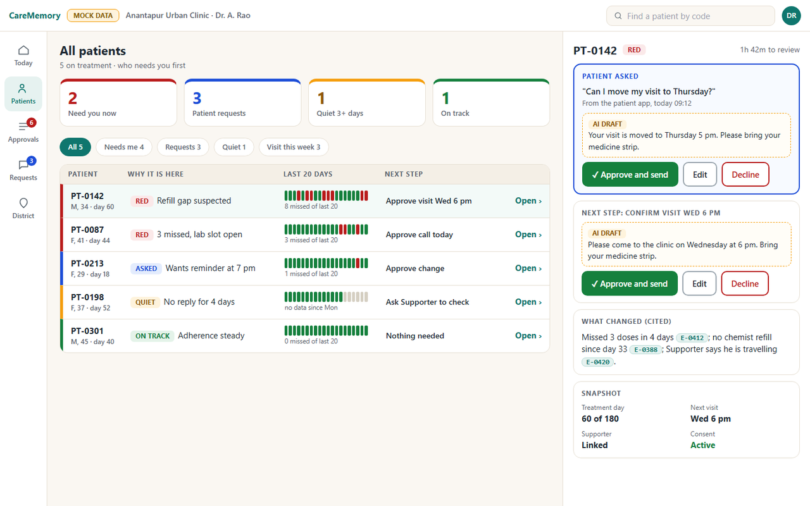 | 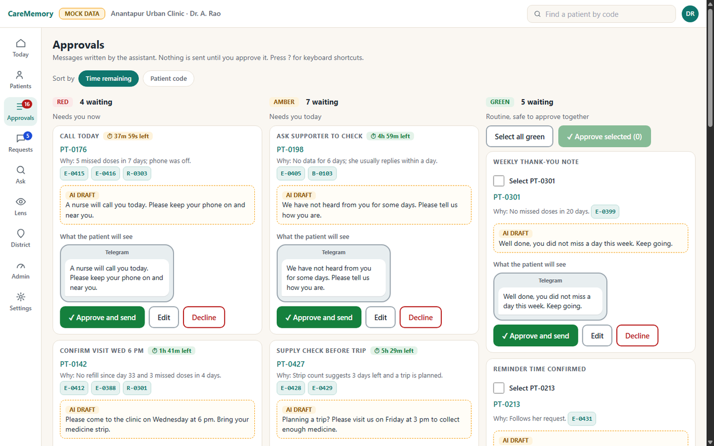 | 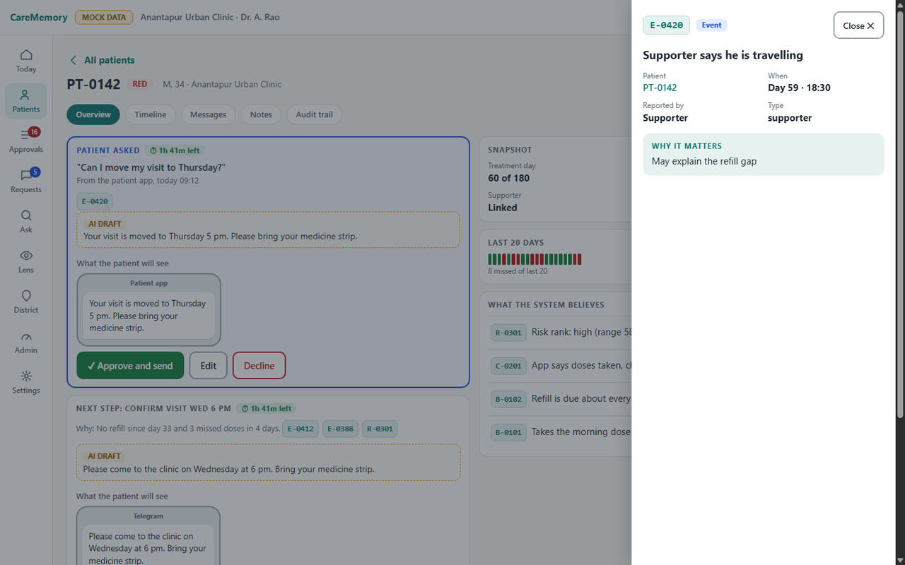 |
| **Memory Lens: Day 60** | **Patient timeline** | **Ask box with citations** |
| 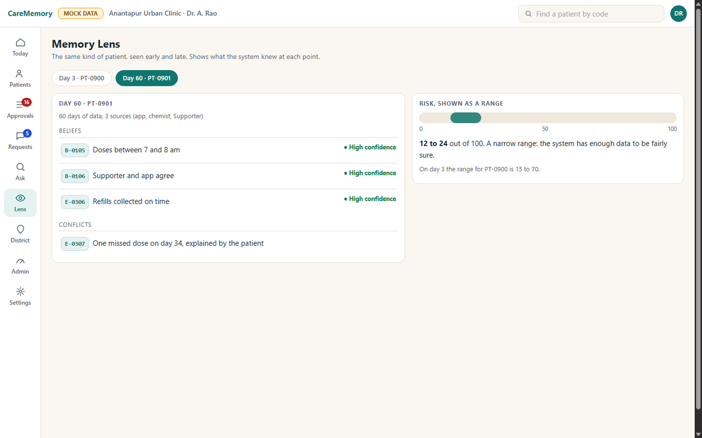 | 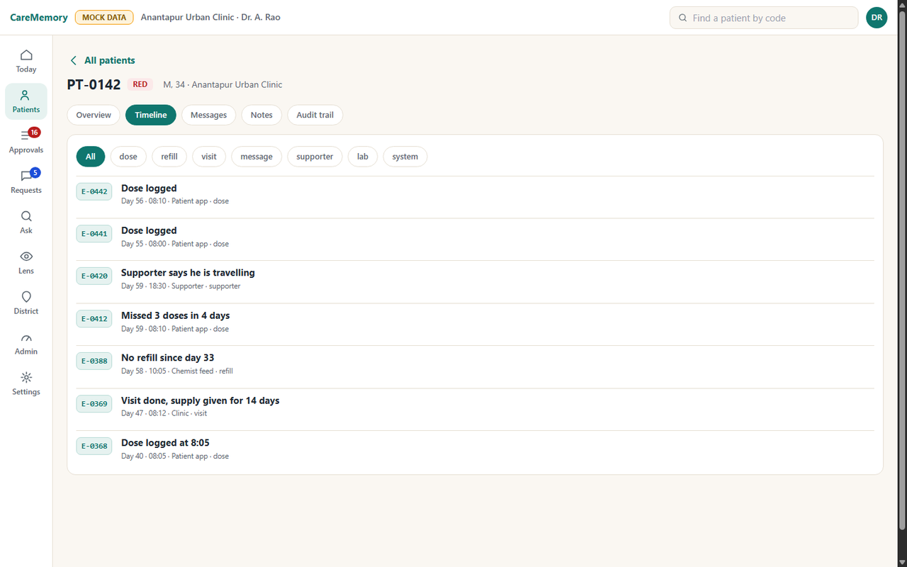 | 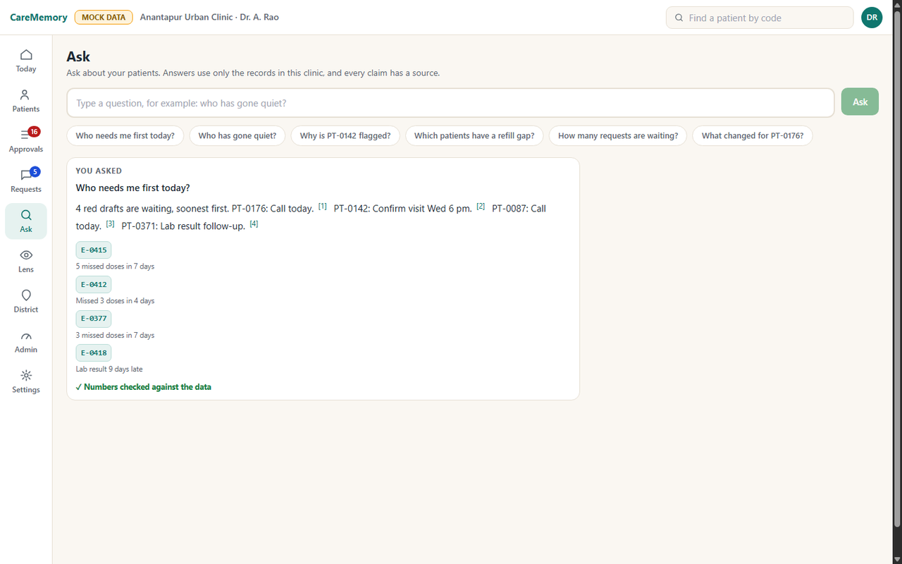 |
| **Admin: AI usage and caps (AMBER)** | **District view** | **Today** |
| 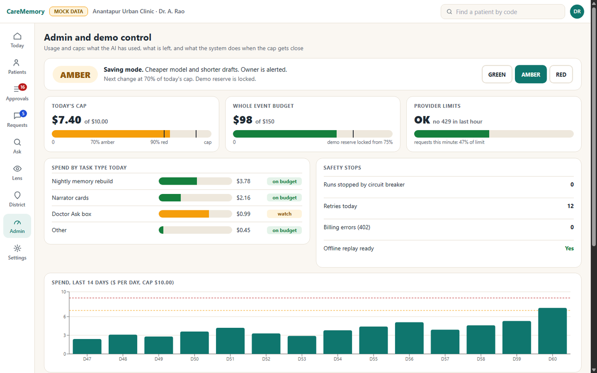 | 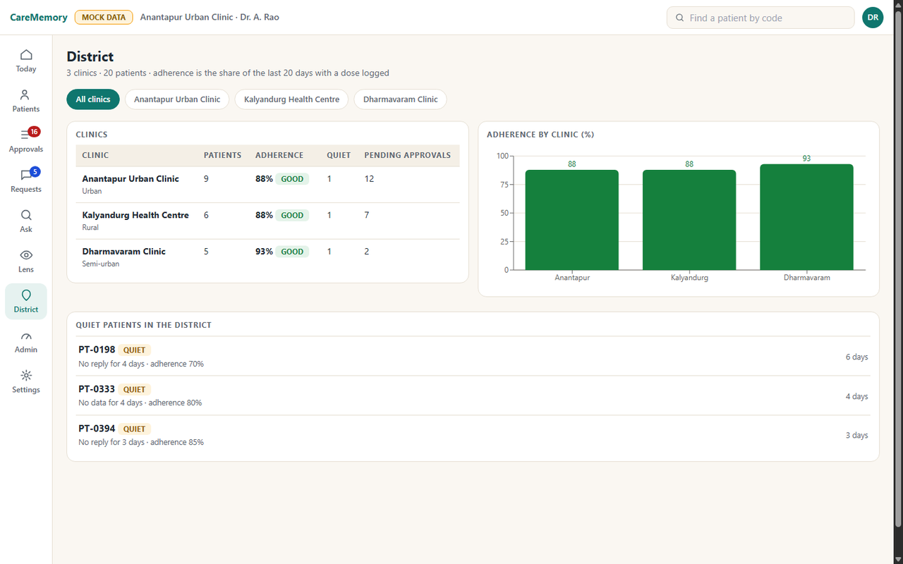 | 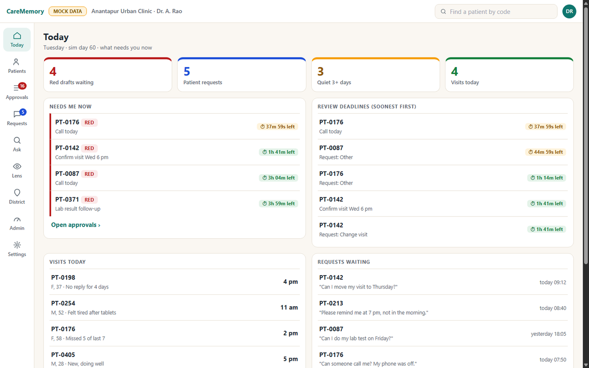 |
| **Patient app (laptop)** | **Patient app in Telugu** | **Consent revoke dialog** |
| 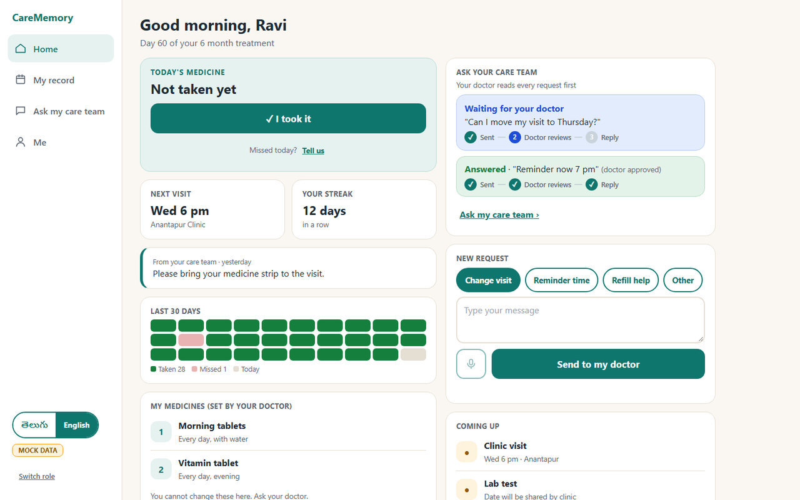 | 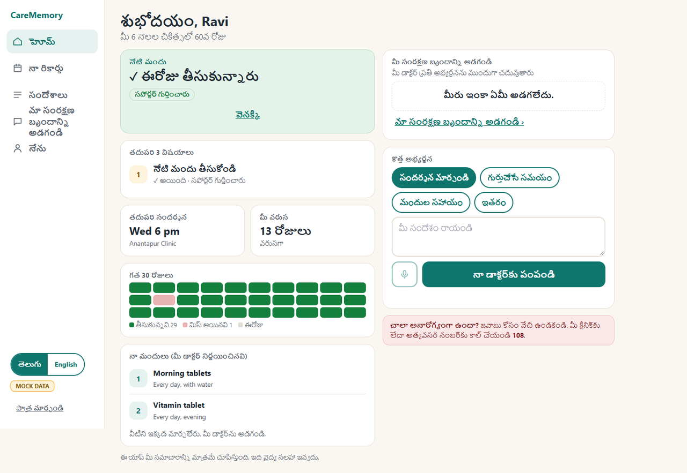 | 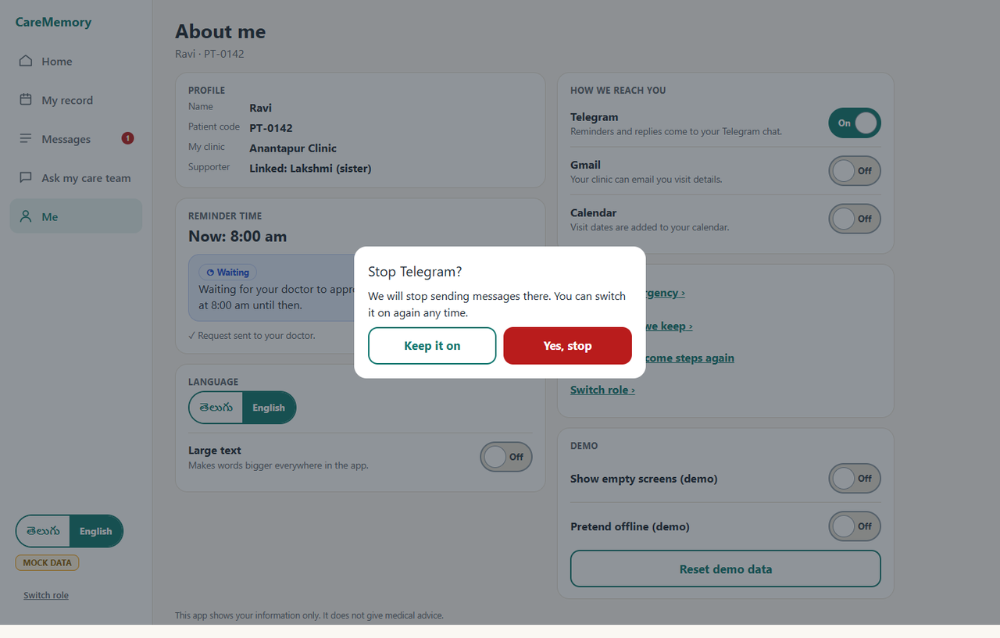 |

<p>
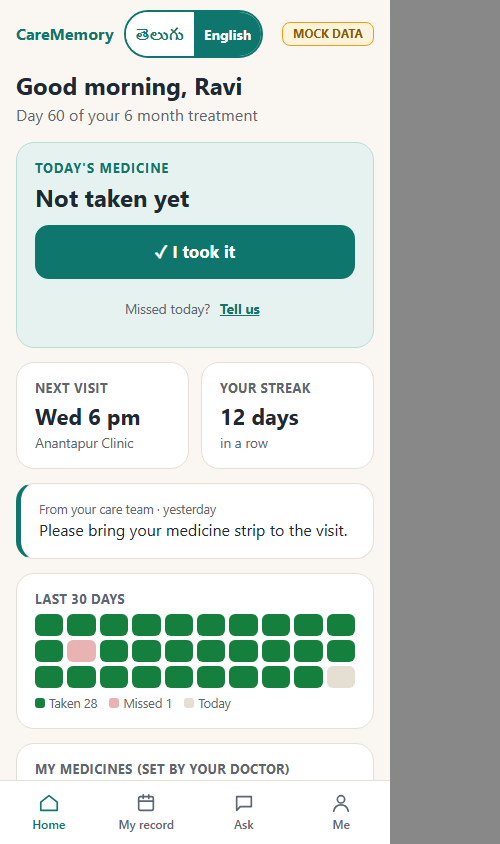
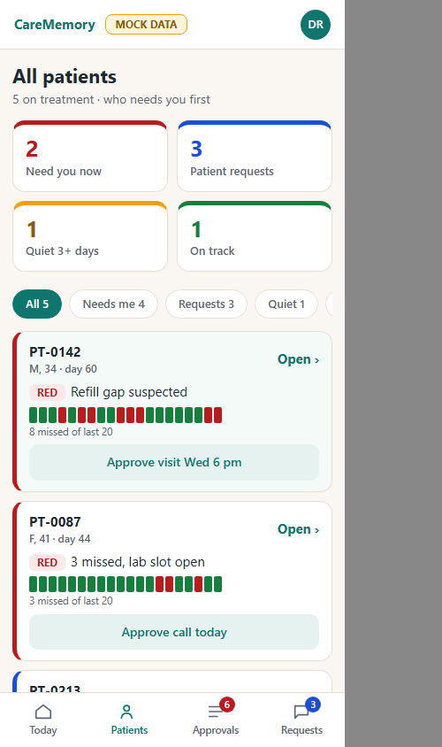
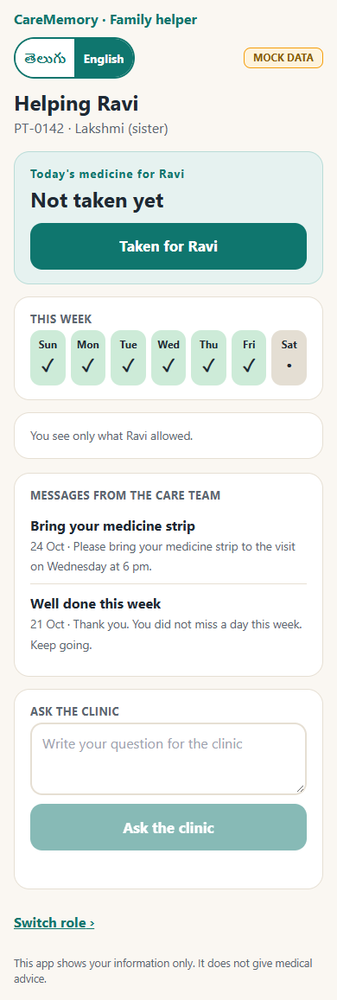
</p>

## 4. Features and honest status

| Area | Feature | Status | Evidence |
|---|---|---|---|
| Data | Postgres schema, 7 migrations (events, approvals, outbox, consents, memory tables, RAG tables, auth, views, role grants) | **done** | `cm/store/migrations/`, `tests/integration/test_repos.py` |
| Data | Append-only event store with idempotency keys and `recorded_at` | **done** | `cm/store/events_repo.py`, integration tests |
| Gate | Doctor gate as DB `CHECK` + trigger on `outbox` | **done** | `0002_reliability.sql`, `tests/integration/test_decide.py` |
| Gate | Single `decide()` transaction (console, Gmail, sweeper) | **done** | `cm/review/decide.py`, `test_decide.py` |
| API | Auth: scrypt passwords, HS256 JWT cookie, role guards, login rate limits | **done** | `cm/api/auth.py`, `cm/api/routers/auth.py`, `tests/unit/api/test_auth_unit.py` |
| API | Doctor routes: review queue, bulk decision, patients, timeline, requests, dashboard, settings | **done** | `cm/api/routers/`, `tests/integration/test_e2e_api.py` |
| API | Patient portal routes: today, dose, record, inbox, requests, consents, Supporter check-in | **done** | `cm/api/routers/portal.py`, e2e tests |
| API | Banned-term filter on every patient and Supporter response | **done** | `cm/api/suppress.py`, `tests/unit/api/test_suppress.py` |
| API | Ask box: answers built from DB rows with numbered citations and a number check | **done** (rule-based) | `cm/api/routers/query.py`; LLM version in progress (below) |
| API | Live updates (SSE `/stream`), district endpoint, dose undo, documents | **partial** (in progress today, lane G) | `cm/api/routers/stream.py`; web falls back to 5 s polling |
| Seed | Deterministic seed 42 (same sample content as the UI), idempotent | **done** | `cm/jobs/seed.py`, `tests/integration/test_seed.py` |
| Content | 12 approved message templates, English + Telugu (Telugu flagged for native review) | **done** | `cm/router/templates/*.yaml`, `tests/unit/content/` |
| Content | Banned-term scanner over templates and patient/Supporter UI | **done** | `scripts/banned_terms.py` (clean on 24 Oct) |
| AI | Budget governor GREEN/AMBER/RED, demo reserve, circuit breaker, retry with retry-after, no retry on 402/auth | **done** | `cm/core/budget.py`, `retry.py`, `tests/unit/core_ai/test_ai.py` |
| AI | Governed `get_model(role)`, PII tokenise + `assert_clean()` before any LLM call | **done** | `cm/core/llm.py`, `tokenize.py`, unit tests |
| AI | Deep Agents orchestrator, narrator and drafter sub-agents, LangGraph `interrupt()` at `submit_for_review` | **partial** (being built today, change `add-ai-runtime`) | `cm/agents/`, `cm/tools/`, `cm/validator/` |
| AI | Cite-or-cut validator | **partial** (being built today) | `cm/validator/cite_or_cut.py` |
| AI | Intake, identity, curator, investigator sub-agents | **planned** | stubs in `cm/agents/subagents/` |
| Memory | Beliefs, weekday pattern detector, per-reporter trust, drift alarm, calibrated risk with interval | **planned** | schema exists (`0003_memory.sql`); stubs in `cm/memory/` |
| Rules | Reconciler rules R1 to R6 (refill vs self-report, payment mismatch, danger symptom, silence, household contacts) | **planned** (only the Telegram fast path runs today) | stubs in `cm/rules/` |
| Telegram | Webhook: secret check, dedupe on `update_id`, tap saved as event first, ack under 1 s | **done** (tested with fakes and Postgres) | `cm/channels/tg_inbound.py`, `tests/unit/channels/`, `tests/integration/test_telegram_pg.py` |
| Telegram | Fast path: 3 missed in 3 days or a danger symptom creates a Red draft (fixed text, no LLM) | **done** | `cm/channels/adapters_pg.py`, integration test |
| Telegram | Outbox sender: approved rows only, quiet hours 21:00 to 07:00, 1 msg/s per chat, 3 per day, retry-after | **done** | `cm/channels/tg_sender.py`, `cm/jobs/outbox_drainer.py` |
| Telegram | Live bot run | **partial** | needs the owner's bot token and ngrok; steps in `cm/channels/NOTES_integration.md` |
| Telegram | Onboarding wizard with itemised consent, free-text intake, Supporter proxy taps | **planned** | listed in `cm/channels/NOTES.md` |
| Gmail | Digest builder, reply parser ("approve 1, reject 2 reason"), single-use token check, consent flows, calendar visits, channel fallback | **partial** (tested against fakes only) | `cm/channels/gmail*.py`, `tests/unit/gmail/` |
| Gmail | Real Google API client, OIDC check on Pub/Sub push | **planned** | `cm/channels/NOTES_gmail.md` |
| Web | Doctor console: Today, Patients, patient page with tabs, Approvals with SLA countdown and bulk approve, Requests, Ask, Memory Lens, District, Admin usage caps, Settings, keyboard shortcuts, undo toast | **done** (screens) | `web/src/pages/`, screenshots above |
| Web | Patient app: welcome and consent, home, record, messages, ask, me (consent revoke, large text), help, privacy; English/Telugu | **done** (screens) | `web/src/pages/PatientApp/` |
| Web | Supporter view | **done** (screens) | `web/src/pages/Supporter/` |
| Web | Real HTTP adapter (cookie session, 401 to login, GET-only retry, optimistic update with rollback), SSE with polling fallback | **done** | `web/src/api/httpAdapter.ts`, `mapping.test.ts` (14 tests) |
| Web | Memory Lens and District on real memory data | **partial** | screens exist; backed by sample data until the memory engine lands |
| Eval | 60-day synthetic simulator, eval harness, LLM judge, cassette replay for offline demo | **planned** | stubs in `cm/sim/`, `cm/eval/` |
| Deploy | Dockerfile, docker-compose (pgvector/pg16), numbered GCP scripts, Cloud Build | **partial** (written, not yet deployed) | `infra/00_project.sh` to `80_webhooks.sh`, `infra/cloudbuild.yaml` |
| Deploy | Cloud Tasks mode for the task queue | **planned** | local in-process queue only (`TASKS_MODE=local`) |

## 5. Architecture

PNG copies of every diagram are in [docs/assets/diagrams/](docs/assets/diagrams/) (rendered with Mermaid 11.4.1). Colour key: teal = done, amber = partial, grey dashed = planned.

### 5.1 System architecture

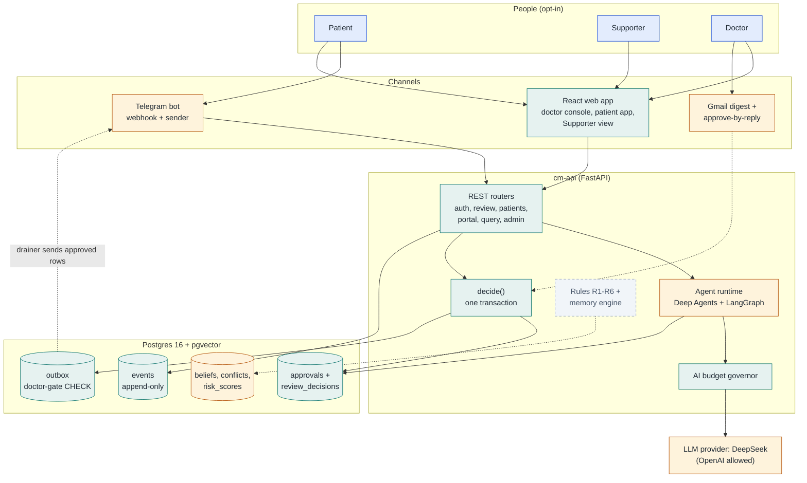

### 5.2 Data flows: Ask box, Telegram tap, Gmail reply

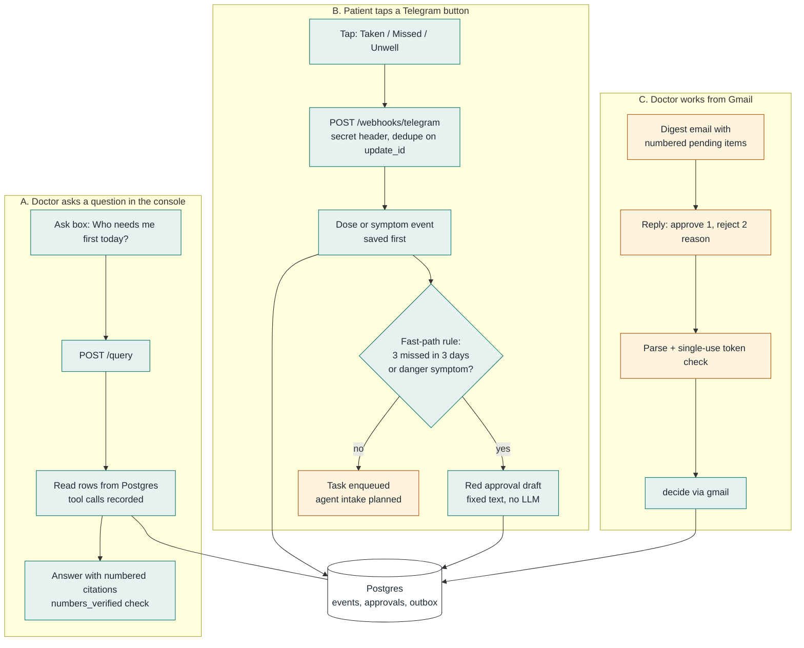

### 5.3 Agent graph (target design; orchestrator and narrator are being built today)

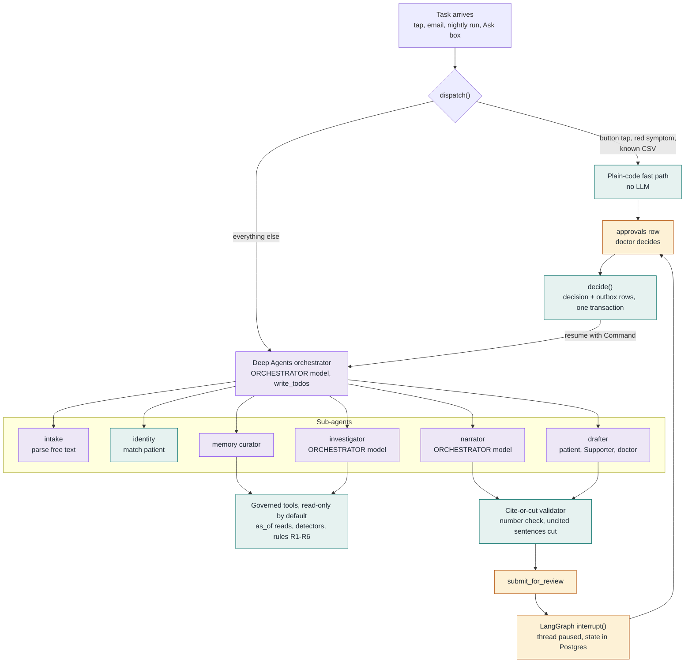

### 5.4 Doctor-gate approval sequence (built and tested)

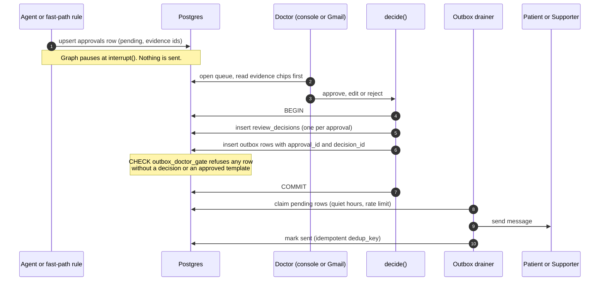

### 5.5 AI budget states (built and tested)

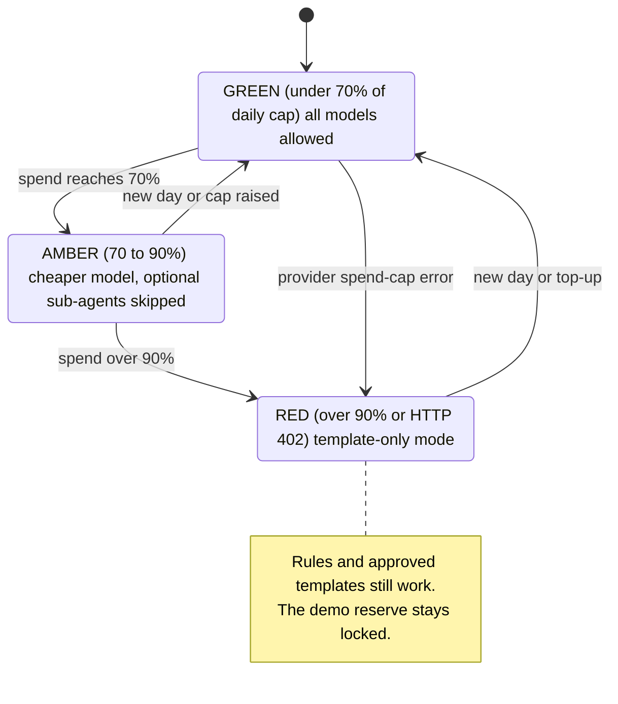

Thresholds from [`cm/core/budget.py`](cm/core/budget.py): exactly 90% is AMBER; RED is strictly over 90%. The demo reserve is locked by shrinking the spendable daily cap.

### 5.6 Main tables (ER overview)

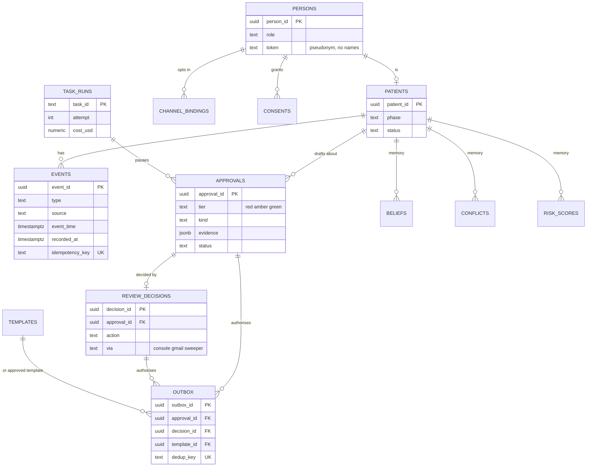

### 5.7 Deployment

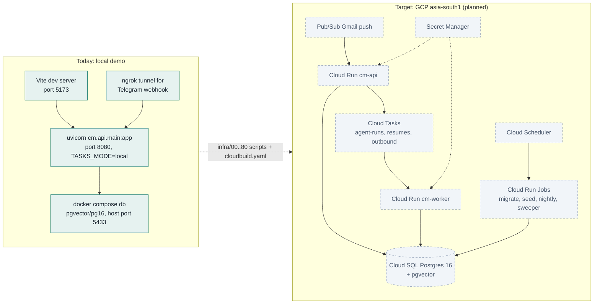

Earlier design diagrams (framework architecture, data flow, lanes) are in [docs/assets/diagrams/design/](docs/assets/diagrams/design/).

## 6. Tech stack and models

| Layer | Technology |
|---|---|
| Backend | Python 3.12 (3.11+ supported), FastAPI, Pydantic v2 strict, psycopg 3, uvicorn |
| AI runtime | LangChain v1 `init_chat_model`, LangGraph 1.2.x (`interrupt()`, Postgres checkpointer), deepagents 0.7.30 |
| Database | Postgres 16 + pgvector (Docker image `pgvector/pgvector:pg16`; Cloud SQL target) |
| Web | React 18, Vite 5, TypeScript 5.6, Tailwind 3, TanStack Query, Recharts, Vitest |
| Channels | Telegram Bot API (httpx), Gmail API + Pub/Sub push, Google Calendar |
| Cloud (target) | Cloud Run services and jobs, Cloud SQL, Cloud Tasks, Pub/Sub, Secret Manager, Cloud Scheduler, region asia-south1 |
| Build-time memory | OpenSpec 1.14.3 (every feature, removal and fix logged under `openspec/`) |
| Quality | pytest, ruff, import-linter, banned-term scanner |

**Model to task.** Models are reached only through `cm.core.llm.get_model(role)`; names live in `.env`, never in code. Providers allowed at runtime: OpenAI or DeepSeek only (DeepSeek is refused when `CM_DATA_CLASS=real`). Names below were confirmed with the provider's `/models` call; prices are approximate and change, so the governor reads a price table from `CM_PRICE_TABLE_JSON`.

| Role | Model | Used for |
|---|---|---|
| `ORCHESTRATOR` | `deepseek:deepseek-v4-pro` | Deep Agents orchestrator, narrator (memory card), investigator lead |
| `WORKER` | `deepseek:deepseek-flash` | Drafts for patient/Supporter/doctor, Ask box, intake and curator sub-agents |
| `JUDGE` | `deepseek:deepseek-flash` | Faithfulness judge in evaluation |
| `FALLBACK` | `deepseek:deepseek-flash` | After repeated timeouts or 5xx (never after a spend-cap error) |
| `VISION` | off | Lab reports come in as JSON/CSV for now |
| `EMBEDDING` | off | Postgres full-text search fallback for now |

## 7. Safety and privacy

- **Mock data only.** Every patient, phone number and record in this repo is synthetic. The seed is deterministic (seed 42).
- **Opt-in channels, consent per purpose.** Consent is stored per person, channel and purpose (`daily_checkin`, `care_coordination`, `supporter_sharing`, `programme_monitoring`); `/stop` in Telegram withdraws consent and revokes the binding. Events without consent are refused by a table `CHECK`.
- **No disease or drug words reach patients.** Patient and Supporter text never contains the disease name, its abbreviation or drug names. `cm/api/suppress.py` filters responses; `scripts/banned_terms.py` scans templates and patient/Supporter screens (clean on 24 Oct).
- **PII never goes to an LLM.** `cm.core.tokenize.tokenize()` replaces identifiers before a prompt is built; `assert_clean()` blocks the call otherwise. People are stored as pseudonymous tokens; names sit in an `identity_vault` table.
- **Doctor approval for every AI output**, enforced by the database (section 2). No diagnosis or dosing advice: CareMemory coordinates follow-up, the doctor decides.
- **Secrets** live only in a git-ignored `.env` or Secret Manager. `.env.example` holds names and placeholders only.

## 8. Repository map

| Path | Purpose | Lane |
|---|---|---|
| `cm/contracts/` | Pydantic contracts, frozen at tag `contracts-v1` (changes only by RFC in `CHANGES.md`) | L0 |
| `cm/core/` | Config, DB pool, clock, ids, logging, task queue, budget governor, retry, LLM access, PII tokeniser | A |
| `cm/store/` | Migrations and repositories (the only place with raw SQL, with `cm/memory/`) | A |
| `cm/review/` | `decide()`: the single doctor-decision transaction | G |
| `cm/api/` | FastAPI app and routers | G (B, J, K own some routers) |
| `cm/channels/` | Telegram, Supporter, Gmail, Calendar, consent flows, Postgres adapters | F, M |
| `cm/router/` | Channel routing, quiet hours, banned-term check, templates | F, K |
| `cm/agents/`, `cm/tools/`, `cm/validator/` | AI runtime, governed tools, cite-or-cut and injection checks | E, N, D |
| `cm/memory/`, `cm/rules/`, `cm/identity/` | Memory engine, reconciler rules, identity matching (mostly planned) | C, D |
| `cm/sim/`, `cm/eval/`, `cm/rag/` | Simulator, evaluation, guideline retrieval (planned) | B, J, K |
| `cm/jobs/` | Command-line jobs: migrate, seed, reminders, outbox drainer, invites, webhook setup | A, B, F |
| `web/` | React doctor console, patient app, Supporter view | H1, H2 |
| `tests/` | `unit/`, `integration/` (needs Postgres), `contract/`, `redteam/`, `replay/` | all |
| `infra/` | Numbered GCP scripts, Cloud Build, env files, local Postgres init | I |
| `scripts/` | Banned-term scanner, ngrok and Telegram webhook helpers | I, K |
| `openspec/` | Build-time memory: one archived change per feature or fix | all |
| `docs/` | This page as HTML, design docs, diagrams, screenshots | docs |

## 9. How to run

Prerequisites: Python 3.11+, Docker, Node 20.19+, Git Bash on Windows. Every command below exists in this repo; the ones marked with a tick were run on 24 Oct 2026.

```bash
cp .env.example .env                      # fill values locally; never commit .env. Set DB_PORT=5433 if 5432 is taken
python -m venv .venv && source .venv/Scripts/activate    # macOS/Linux: .venv/bin/activate
pip install -r requirements-dev.txt
docker compose up -d db                   # Postgres 16 + pgvector on host port ${DB_PORT:-5432}   (ticked: running on 5433)
python -m cm.jobs.migrate                 # applies cm/store/migrations 0001..
python -m cm.jobs.seed --reset            # deterministic seed 42 (--small for 6 patients); writes demo logins to .env
python -m uvicorn cm.api.main:app --port 8080            # (ticked: GET /healthz returns {"status":"ok"})
cd web && npm ci && npm run dev           # http://localhost:5173 (VITE_USE_MOCK=false uses the real API)
```

Tests:

```bash
python -m pytest -m "not live and not slow and not docs" -q   # (ticked) unit + integration; DB tests use database caremem_test
cd web && npx vitest run                                       # (ticked)
python scripts/banned_terms.py                                 # (ticked) prints "banned-terms: clean"
```

Telegram locally (owner step, needs a bot token in `.env`): `ngrok http 8080`, then `python scripts/tg_set_webhook.py`, `python -m cm.jobs.make_invite --patient PT-0142`, send `/start CODE` to the bot, `python -m cm.jobs.reminders --now` and `python -m cm.jobs.outbox_drainer --once`. Full steps: [cm/channels/NOTES_integration.md](cm/channels/NOTES_integration.md).

The `Makefile` wraps the same steps (`make up migrate seed`, `make test`, `make check`) for Git Bash or WSL. GCP deployment scripts are in `infra/` (run in numeric order after `source infra/vars.sh`); they have not been run against a live project yet.

## 10. Environment variables (names only)

Never put values in the repo. Full list with placeholders: [.env.example](.env.example).

| Group | Names |
|---|---|
| Runtime | `CM_ENV`, `CM_ROLE`, `CM_DATA_CLASS`, `CM_OFFLINE`, `DEMO_MODE`, `TZ`, `LOG_LEVEL`, `PORT`, `TASKS_MODE` |
| Database | `DB_CONNECT_MODE`, `DB_HOST`, `DB_PORT`, `DB_NAME`, `DB_USER`, `DB_PASSWORD`, `DB_USER_APP`, `DB_PASSWORD_APP`, `CLOUD_SQL_INSTANCE`, `CM_TEST_DB_NAME` |
| LLM | `OPENAI_API_KEY`, `DEEPSEEK_API_KEY`, `ORCHESTRATOR_MODEL`, `WORKER_MODEL`, `JUDGE_MODEL`, `FALLBACK_MODEL`, `VISION_MODEL`, `EMBEDDING_MODEL`, `LLM_TIMEOUT_S` |
| AI budget | `CM_BUDGET_DAILY_USD`, `CM_BUDGET_TASK_USD`, `CM_BUDGET_PATIENT_TOKENS`, `CM_BUDGET_RESERVE_USD`, `CM_BUDGET_RESERVE_UNLOCKED`, `CM_MAX_TOOL_CALLS`, `CM_MAX_SUBAGENT_DEPTH`, `CM_PRICE_TABLE_JSON`, `DAILY_COST_CAP_USD` |
| Telegram | `TELEGRAM_BOT_TOKEN`, `TELEGRAM_WEBHOOK_SECRET`, `TELEGRAM_PER_CHAT_RPS`, `TELEGRAM_GLOBAL_RPS`, `INBOUND_PER_CHAT_PER_MIN`, `PUBLIC_BASE_URL`, `FASTPATH_MISSED_THRESHOLD` |
| Gmail / Calendar | `GMAIL_OAUTH_CLIENT_JSON`, `GMAIL_REFRESH_TOKEN`, `GMAIL_MAILBOX`, `DOCTOR_EMAIL_ALLOWLIST`, `GMAIL_PUBSUB_TOPIC`, `PUBSUB_PUSH_AUDIENCE`, `GOOGLE_CALENDAR_ID` |
| Security | `JWT_SIGNING_KEY`, `JWT_TTL_MIN`, `PII_MASTER_KEY`, `DEMO_USER_PASSWORDS`, `LOGIN_PER_IP_PER_MIN`, `CORS_ORIGINS`, `COOKIE_SECURE` |
| GCP | `GCP_PROJECT`, `GCP_REGION`, `GCS_DOCS_BUCKET`, `WORKER_URL`, `TASKS_QUEUE_AGENT_RUNS`, `TASKS_QUEUE_RESUMES`, `TASKS_QUEUE_OUTBOUND` |
| Web | `VITE_USE_MOCK`, `VITE_API_BASE` (see `web/.env.example`) |

## 11. Testing

Counts below were measured on 24 Oct 2026 in this working tree (two other lanes were still adding code, so later runs may show more tests).

| Suite | Command | Result |
|---|---|---|
| Python unit | `pytest tests/unit -m "not live and not slow and not docs"` | **165 passed** |
| Python integration (real Postgres) | `pytest tests/integration` | **41 passed** |
| Smoke | `pytest tests/test_smoke.py` | 1 passed |
| Whole quick suite | `pytest -m "not live and not slow and not docs"` | **207 passed** in 17 s |
| Web | `npx vitest run` | **14 passed** (HTTP mapping) |
| Content | `python scripts/banned_terms.py` | clean |
| API boot | `uvicorn cm.api.main:app`, `GET /healthz` | `{"status":"ok"}`; `GET /patients` without login returns 401 |

What the integration tests cover: the decision transaction and the outbox doctor gate (`test_decide.py`), repositories (`test_repos.py`), seed idempotency (`test_seed.py`), the API end to end with login (`test_e2e_api.py`) and the Telegram path against Postgres (`test_telegram_pg.py`). Not yet covered: live LLM calls (`@pytest.mark.live`), red-team prompts, replay cassettes and the 60-day evaluation.

## 12. Evaluation mapping

Organisers' latest weighting: **Round 1 = 40%, Round 2 = 60%** (the older 15/35/50 plan is kept in [docs/design/EVALUATION_PLAN.md](docs/design/EVALUATION_PLAN.md)). Round 2 rubric, raw maximum 50, scaled to 60:

| # | Criterion (raw max) | Share of 100 | What we show |
|---|---|---|---|
| R1 | Idea and solution presentation, repo progress tracker | 40 | This README, diagrams, [TRACKER.md](TRACKER.md), one commit per feature slice |
| 1 | Functionality and working demo (15) | 18 | Doctor approves a patient request and the patient app shows "doctor approved"; a Telegram tap becomes an event and a Red draft; Ask box answers with citations |
| 2 | Technical depth and code quality (10) | 12 | DB-level doctor gate, single `decide()` transaction, budget governor, PII tokeniser, cite-or-cut, frozen contracts, 220+ tests, OpenSpec log |
| 3 | UI/UX and usability (5) | 6 | Responsive console and patient app (360 px to 1440 px), Telugu toggle, large text, empty states, keyboard shortcuts |
| 4 | Completeness vs proposed scope (5) | 6 | Section 4 and TRACKER.md: honest done / partial / planned against the problem statement's expected outputs |
| 5 | Viability and deployment readiness (5) | 6 | Spend caps with RED template-only mode, consent model, no PII to LLMs, Docker image, GCP scripts, cost per patient |
| 6 | Q&A handling and team contribution (5) | 6 | Lane ownership (section 8), OpenSpec change per feature, design docs in `docs/design/` |
| 7 | Final presentation and demo delivery (5) | 6 | Ravi's Day 3 vs Day 60 story, rehearsed demo path |

## 13. Roadmap

**Before the final round (next hours)**
1. Finish the AI runtime: orchestrator, narrator memory card, cite-or-cut, nightly job (change `add-ai-runtime`).
2. Memory engine v1 and rules R1 to R6, so Memory Lens and the risk range come from real data.
3. Live Telegram demo with the owner's bot; Gmail on the real API if time allows.
4. Deploy to Cloud Run (scripts ready) with min instances 1; keep the local stack as the offline backup.

**After the hackathon**
1. Pilot with one private clinic on synthetic-then-consented data, with a native-speaker review of every Telugu template.
2. 60-day evaluation on held-out seeds with calibration plots; red-team suite for prompt injection.
3. Move to an India-region provider with zero data retention before any real patient data (`CM_DATA_CLASS=real` already refuses DeepSeek).

## 14. Team

**The Sentience Circuit**, JNTU Anantapur Innovators Conclave 2026.

| Member | Role |
|---|---|
| Manobiram (Rammanobi) | Product owner, architecture, integration |
| Idris | Team member |
| Abhishek | Team member |

Built with parallel AI coding agents, one lane each, coordinated through frozen contracts and OpenSpec; every lane's changes are logged under [openspec/changes/archive/](openspec/changes/archive/).

---

<sub>CareMemory coordinates follow-up. It does not diagnose or give dosing advice; the doctor decides.</sub>
