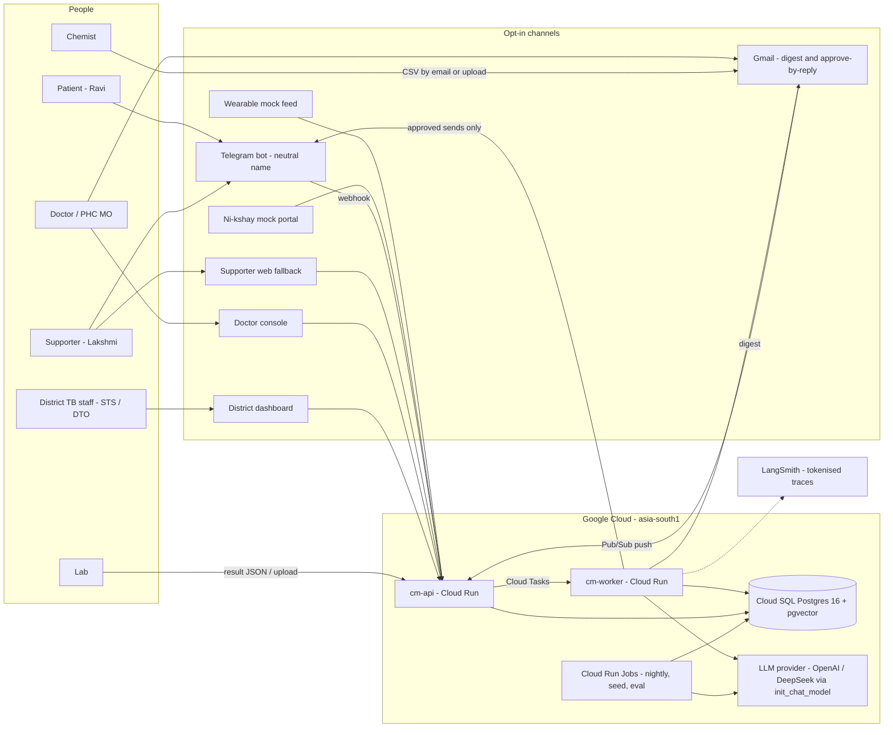
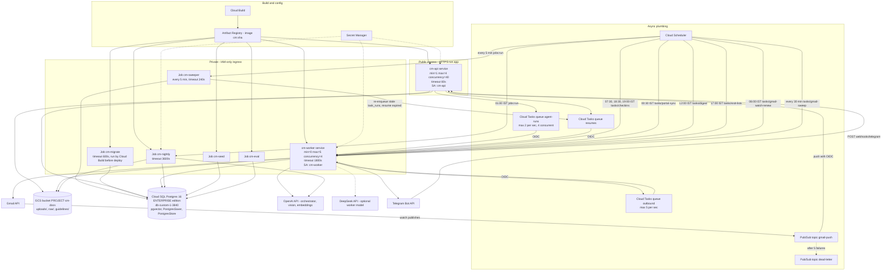
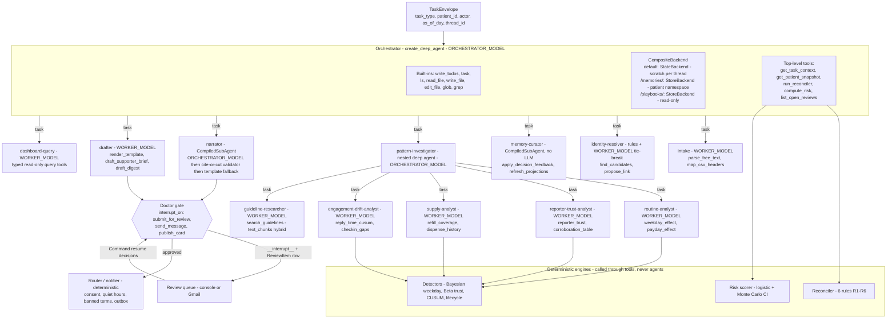
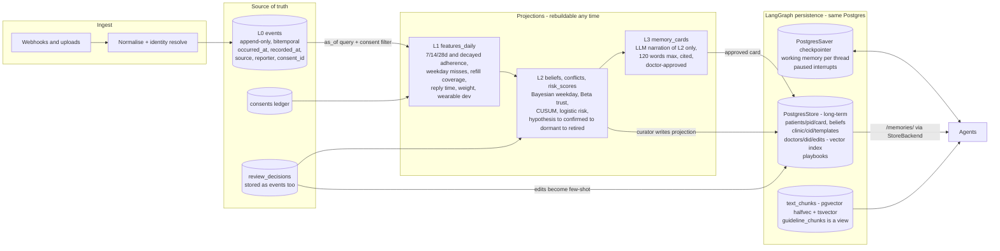
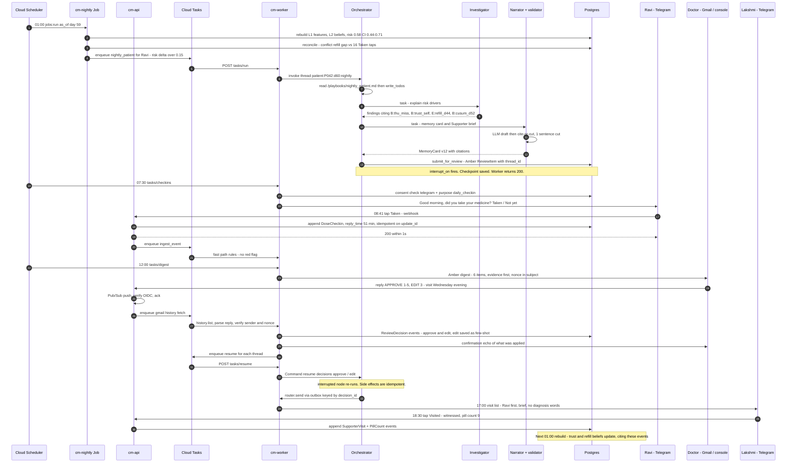
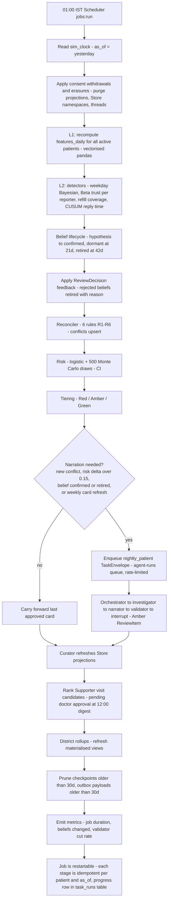
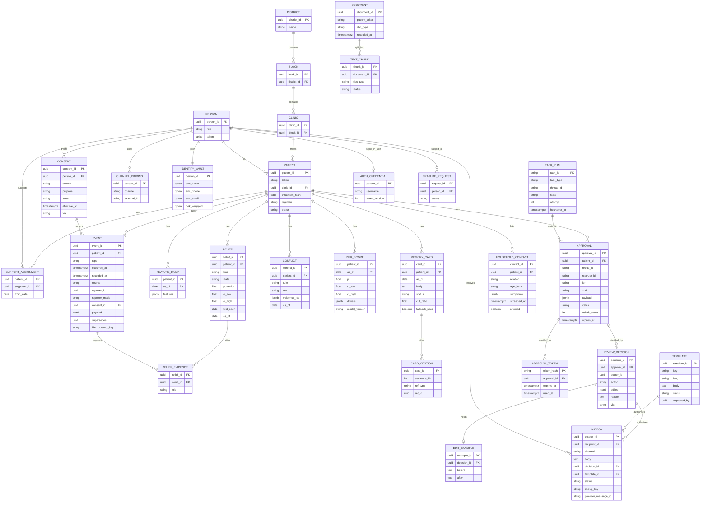
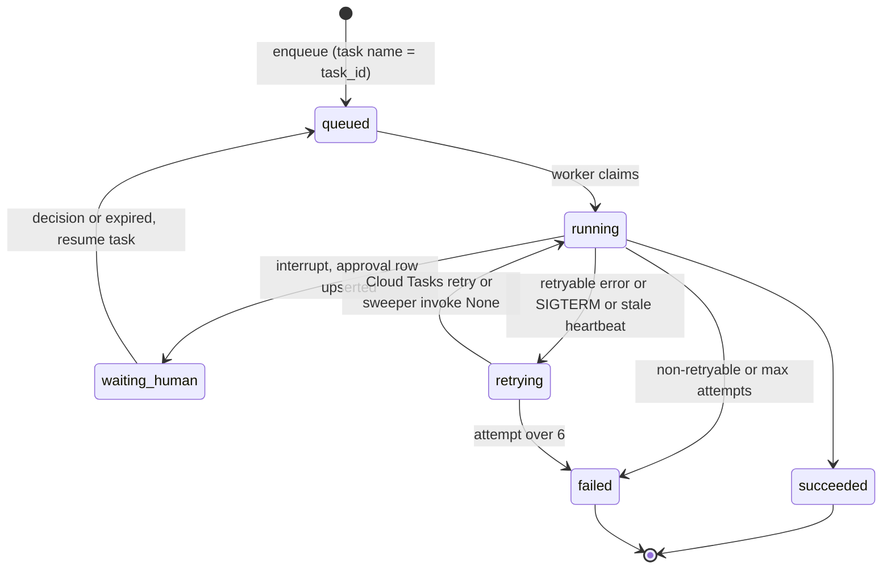

# CareMemory: build architecture (v1, frozen at hour 0)

**What this document is for:** it is the single build spec for tomorrow's 36-hour build. Opus plans and integrates. Sonnet and Haiku agents (the *build* agents in Claude Code) build in parallel git worktrees. The *runtime* LLMs inside CareMemory are OpenAI and/or DeepSeek (see §3.0.1).

**Inputs:**
- `CAREMEMORY_PROBLEM_STATEMENT.md`
- `SAATHILOOP_FINAL_DESIGN.md` (the memory design; "Saathi" is now **Supporter**)
- `TECH_RESEARCH_NOTES.md` (API facts verified 23 Oct 2026)
- `PROJECT_CATALOG.md` (builder skills: FastAPI, LangGraph, Pydantic structured outputs, Cloud Run, Cloud Tasks, React+Vite, Telegram, Gmail)

**One-line product:** *Day 3, it reminds. Day 60, it understands.* CareMemory is an opt-in TB care loop. It builds a longitudinal, cited, doctor-approved memory of each patient, and uses it to send scarce human Supporters to the right patients.

**⚠ convention:** ⚠ marks an API name, parameter or model ID that the build agent must confirm against the installed package (`inspect.signature`) or the GCP console before relying on it. Everything without ⚠ is either verified in `TECH_RESEARCH_NOTES.md` or is our own code.

---

## 0. Decisions at a glance

| Area | Decision |
|---|---|
| Language/runtime | Python 3.12, `uv`, FastAPI, Pydantic v2, psycopg 3 |
| Agent framework | LangChain v1 + LangGraph 1.2.x + `deepagents` 0.7.30 (`create_deep_agent`). No `langgraph-supervisor` (archived), and no LangMem on the critical path (stale, 0.0.30) |
| Orchestration | Every task becomes a `TaskEnvelope`, handled by the **Orchestrator deep agent**, which plans with `write_todos` and delegates via `task` to specialist sub-agents. Safety rules run deterministically *before* the orchestrator and never depend on it |
| State | One Cloud SQL Postgres 16 instance holds four things: the event log (source of truth), projections, LangGraph `PostgresSaver` (checkpointer), and `PostgresStore` (long-term memory + pgvector index) |
| Compute | One container image with three roles: `cm-api` (public Cloud Run service), `cm-worker` (private Cloud Run service, the Cloud Tasks target), and Cloud Run Jobs (`cm-nightly`, `cm-sweeper`, `cm-seed`, `cm-eval`, `cm-migrate`) |
| Integration decisions | `INTEGRATION_DECISIONS.md` (23 Oct) is binding. It holds the final table, endpoint and schema lists and the 14-lane plan. Where this document and it differ, it wins |
| Async | Cloud Tasks for all agent runs, resumes and outbound sends. Pub/Sub only for Gmail push (required by Gmail) and a dead-letter topic. Cloud Scheduler for all timers |
| Region | `asia-south1` (Mumbai) for everything that stores data. LLM calls go to the configured provider (OpenAI or DeepSeek, outside India), carrying **tokenised mock data only** |
| LLMs | **Provider-agnostic** via LangChain `init_chat_model("openai:<model>")` or `("deepseek:<model>")`. The model for each role comes from env: `ORCHESTRATOR_MODEL`, `WORKER_MODEL`, `VISION_MODEL`, `EMBEDDING_MODEL` (+ optional `JUDGE_MODEL`). **Vision and embeddings require OpenAI**, because DeepSeek has no vision or embedding API. **OpenAI and DeepSeek are the only runtime providers** (no Claude or Gemini at runtime). Keys live in Secret Manager / `.env`, never in code |
| Reliability | `durability="sync"` runs; crash resume via `invoke(None, thread)`; side effects in `@task` with idempotency keys; `RetryPolicy` that retries 429s; an `approvals` table as the doctor queue; a `task_runs` table with heartbeats; a transactional outbox (`FOR UPDATE SKIP LOCKED`); named Cloud Tasks as the global throttle; a sweeper job (§8A) |
| Frontend | React + Vite + Tailwind + Recharts, built to `web/dist` and served by `cm-api` as static files, so there is one HTTPS origin and no CORS |
| Auth (demo) | Seeded mock users with signed JWTs and roles: `doctor`, `supporter`, `sts`, `dto`, `admin`, `chemist`, `lab`. Production would use Identity Platform |
| Data | Mock only: deterministic numpy generator, `truth.json` read only by the evaluator |
| Human gate | A doctor approves **every** AI output, by item (Red/Amber) or by template approved once (Green). This is enforced by a DB constraint on the outbox, not by prompts |

---

## 1. Architecture principles

| # | Principle | What it means in code | How it is enforced |
|---|---|---|---|
| P1 | **Deterministic statistics and rules decide. LLMs plan, narrate and parse** | Risk, beliefs, trust, CUSUM, conflicts and tiers are all numpy/sklearn/rule code. LLMs never produce a number that is stored as a fact | LLM tools are read-only over L2. `Belief` and `RiskScore` rows can only be written by `cm.memory.*` modules (DB role `cm_engine`) |
| P2 | **Doctor gate** | No AI-originated text reaches a patient, Supporter or portal unless a `ReviewDecision` approves it, or it is a Green message rendered from a doctor-approved template | `outbox.approval_ref` is `NOT NULL` with an FK + CHECK. The router refuses rows without approval. `interrupt_on` covers every messaging tool |
| P3 | **Event sourcing** | `memory = f(events, as_of)`. L1–L3 are recomputed, never edited. Corrections are new events with `supersedes` | `events` is INSERT-only (a trigger blocks UPDATE/DELETE, except for the erasure procedure) |
| P4 | **Bitemporal and replayable** | Every event has `occurred_at` and `recorded_at`. Every read takes `as_of`. The sim clock can replay any day | `store.query(pid, as_of)` is the only read path. A lint rule bans raw `SELECT` on events outside `cm/store/` |
| P5 | **Consent-first** | Channels are off by default. Processing is filtered by a `consents` ledger scoped by (person, source, purpose) | `as_of` queries join the effective consent. The router checks consent before every send |
| P6 | **Governed tools, never raw DB access** | Agents only see typed tools. Each tool checks role, patient scope, purpose and consent, tokenises PII, and writes the audit log | `cm/tools/guard.py` decorator. Agents get no DB session and no SQL tool (the query agent uses typed tools only) |
| P7 | **Cite-or-cut** | Every narrated sentence cites event or belief IDs, and every number must match a cited value, or the sentence is cut. If too much is cut, fall back to a template | `cm/validator/cite_or_cut.py` runs on every narration before it can become a ReviewItem |
| P8 | **Safety fast-path is LLM-free** | Red flags (drug-resistance mismatch, danger symptoms) are raised by rules at ingest, inside the event-append transaction | `append_event()` post-commit hook calls `rules.fast_path()`. The orchestrator is not involved |
| P9 | **Idempotent side effects** | LangGraph nodes re-run on resume, and Cloud Tasks retries | Every write has an `idempotency_key`. Outbox sends are keyed by `(review_decision_id, recipient)`. Event appends are keyed by source message ID |
| P10 | **Ack fast, work async** | Webhooks return 200 in under 1 s. Heavy work goes to Cloud Tasks (≤30 min handler) or Cloud Run Jobs | No FastAPI `BackgroundTasks` and no threads after the response, because Cloud Run throttles CPU |
| P11 | **Honest uncertainty** | Every belief and risk carries an interval. The UI shows what the system cannot know ("unknowns it admits") | `RiskScore.ci_low/ci_high` and `Belief.posterior` are required fields |
| P12 | **Never say "TB" to patients** | Patient and Supporter messages use neutral wording ("your medicine", "health check") | Banned-term filter in the router (English, Hindi, Telugu), with a hard block and an alert |

---

## 2. Diagrams

### 2a. System context



### 2b. GCP deployment



### 2c. Deep Agent orchestration



### 2d. Data and memory layers



### 2e. One day in Ravi's loop (sim day 60)



### 2f. Nightly batch flow (`cm-nightly`, a Cloud Run Job)



### 2g. Database ER diagram



---

## 3. Agent design

### 3.0 How a task flows

1. **Entry.** An API handler, Scheduler or nightly job builds a `TaskEnvelope` and enqueues it on the Cloud Tasks queue `agent-runs`. Its `thread_id` is `{task_type}:{patient_token}:{sim_day}:{short_uuid}` (<255 chars).
2. **Run.** `cm-worker` `/tasks/run` calls `orchestrator.invoke(...)` with `config={"configurable": {"thread_id": ..., "ctx": ToolContext}}`. `ToolContext` holds the actor role, patient scope, purpose, `as_of` and `task_type`. Tools read it to authorise.
3. **Plan.** The orchestrator reads `/playbooks/{task_type}.md` (procedural memory), calls `write_todos`, then delegates with `task`.
4. **Pause.** Any gated tool triggers `interrupt_on`. The worker sees `result["__interrupt__"]` and writes a `ReviewItem` (idempotent on `thread_id` + tool-call ID). It returns 200, and the thread sleeps in the checkpointer.
5. **Resume.** A doctor decision enqueues `/tasks/resume`, which calls `orchestrator.invoke(Command(resume={"decisions": [...]}), config=same thread)`.
6. **Retry.** Every run uses `durability="sync"`. If a run dies mid-way, the Cloud Tasks retry (or the sweeper) calls `invoke(None, {"configurable": {"thread_id": ...}})`. Completed steps load from the checkpoint and are not re-run. Full failure handling is in §8A.

### 3.0.1 Model registry (`cm/core/llm.py`)

The runtime LLM layer is **provider-agnostic**. Every model is a `"provider:model"` string read from env and built with LangChain `init_chat_model` (packages `langchain-openai`, `langchain-deepseek`; `deepagents` also accepts the same strings). Concrete model names are ⚠: pick them tonight from the provider dashboards.

| Env var (role) | Example value ⚠ | Allowed providers | Used by |
|---|---|---|---|
| `ORCHESTRATOR_MODEL` | `openai:<flagship-model>` or `deepseek:deepseek-chat` | OpenAI, DeepSeek | Orchestrator, investigator lead, narrator |
| `WORKER_MODEL` | `openai:<mini-model>` or `deepseek:deepseek-chat` | OpenAI, DeepSeek | Intake parsing, investigator sub-agents, drafter, identity tie-break, curator reason structuring, dashboard query |
| `VISION_MODEL` | `openai:<vision-capable-model>` | **OpenAI only** (DeepSeek has no vision API) | Lab PDF/photo reading (stretch). If unset, lab results come only as JSON/CSV |
| `EMBEDDING_MODEL` | `openai:text-embedding-3-small` (1536 dims) | **OpenAI only** (DeepSeek has no embeddings API) | Store semantic index (doctor edits), guideline RAG. If unset, both fall back to Postgres full-text search (`tsvector`) |
| `JUDGE_MODEL` (optional) | the provider *not* used by the orchestrator | OpenAI, DeepSeek | Evaluator faithfulness judge |
| `FALLBACK_MODEL` (optional) | the other provider's model | any | Used by `get_model` after 3 timeouts/5xx (not after spend-cap errors) |
| `CM_OFFLINE=1` | `FakeMessagesListChatModel` ⚠ replaying the cassette | n/a | Offline demo, CI |

```python
# cm/core/llm.py  (sketch)
from langchain.chat_models import init_chat_model
from langchain.embeddings import init_embeddings          # ⚠ import path
from langchain_core.rate_limiters import InMemoryRateLimiter  # ⚠ per-process only

def get_model(role: str):            # role in ORCHESTRATOR|WORKER|VISION|JUDGE
    spec = settings.model_for(role)   # e.g. "deepseek:deepseek-chat" from env
    if role == "VISION" and not spec.startswith("openai:"):
        raise ConfigError("VISION_MODEL must be an OpenAI model")
    m = init_chat_model(spec, temperature=0.0, timeout=60, max_retries=2,
                        rate_limiter=LIMITERS[role])
    fb = settings.fallback_model
    return m.with_fallbacks([init_chat_model(fb, temperature=0.0)]) if fb else m
```

**Rules:**
- All models use `temperature=0` except the drafter (0.3).
- `get_model` adds LangSmith tags, a per-task token budget, and `assert_clean()` (PII check).
- Spend-cap / quota-exhausted errors are **never** retried and never fall back (§8A).
- Structured output uses `with_structured_output(..., method="json_schema" or "function_calling")` ⚠. DeepSeek supports JSON mode/function calling but not strict JSON schema ⚠, so every structured call is followed by Pydantic validation, with one re-prompt and then a template (§8A).

**Data-protection note on providers:** OpenAI and DeepSeek both process prompts **outside India**, and DeepSeek's API is hosted in China. This is acceptable **only because the build uses mock data, tokenised before every call**. For real patient data:
- use OpenAI under a zero-data-retention agreement (or an India-region provider, such as Azure OpenAI in an India region ⚠, or Vertex in `asia-south1` ⚠);
- never use DeepSeek;
- check this against the DPDP Rules on cross-border transfer and NTEP data policy.

The config refuses `deepseek:` models when `CM_DATA_CLASS=real`.

### 3.1 Orchestrator (deep agent)

| Field | Spec |
|---|---|
| Job | Turns any `TaskEnvelope` into a plan, delegates to specialists, assembles the result, and submits it to the doctor gate. It never computes facts itself |
| Inputs | `TaskEnvelope{task_id, task_type, patient_id?, actor, as_of_day, payload, idempotency_key}` |
| Outputs | `TaskResult{status: done/interrupted/failed, review_item_ids, artifacts, todos}` |
| Task types | `ingest_event`, `nightly_patient`, `investigate` (doctor ad hoc), `prepare_visit_list`, `doctor_digest`, `consent_change`. (`dashboard_question` was removed: `/query` runs inline in `cm-api`, see `INTEGRATION_DECISIONS.md` P8) |
| Model | `ORCHESTRATOR_MODEL` |
| Built-in tools | `write_todos` (opt-in in v0.7: enable via the todo middleware/flag ⚠), `task`, `ls`, `read_file`, `write_file`, `edit_file`, `glob`, `grep` (scratch FS) |
| Own tools | `get_task_context`, `get_patient_snapshot(as_of)`, `run_reconciler(as_of)`, `compute_risk(as_of)`, `list_open_reviews`, `submit_for_review(proposal)` ← gated |
| Sub-agents | intake, identity-resolver, memory-curator, pattern-investigator, narrator, drafter, dashboard-query |
| Backend | `CompositeBackend(default=StateBackend, routes={"/memories/": StoreBackend(namespace=lambda rt: ("patients", rt.ctx.patient_token)) ⚠, "/playbooks/": StoreBackend(namespace=("playbooks",))})` |
| `memory=` | `["/playbooks/AGENTS.md"]` ⚠ (global conventions: cite-or-cut, never diagnose, never "TB") |
| `interrupt_on` | `{"submit_for_review": {"allowed_decisions": ["approve","edit","reject"]}, "send_message": {...}, "publish_card": {...}}` |
| Guardrails | Recursion limit 40. Token budget 60k per task. A task-type allowlist of sub-agents and tools, checked in `guard.py` and returning "not permitted for this task". It cannot write L0–L2. One outbound proposal per patient per task. When it fails, it creates a plain "needs human" ReviewItem rather than retrying forever |

**Skeleton (verify signatures ⚠):**

```python
from deepagents import create_deep_agent, CompiledSubAgent           # ⚠ import path
from deepagents.backends import CompositeBackend, StateBackend, StoreBackend

orchestrator = create_deep_agent(
    model=get_model("ORCHESTRATOR"),       # or the raw string settings.ORCHESTRATOR_MODEL
                                           # sub-agent dicts take "model": settings.WORKER_MODEL
    system_prompt=load_prompt("orchestrator.md"),
    tools=[get_task_context, get_patient_snapshot, run_reconciler,
           compute_risk, list_open_reviews, submit_for_review],
    subagents=[INTAKE, IDENTITY, CURATOR_COMPILED, INVESTIGATOR_COMPILED,
               NARRATOR_COMPILED, DRAFTER, QUERY],
    interrupt_on={"submit_for_review": {"allowed_decisions": ["approve", "edit", "reject"]}},
    backend=lambda rt: CompositeBackend(                               # ⚠ factory vs instance
        default=StateBackend(rt),
        routes={"/memories/": StoreBackend(rt, namespace=patient_ns),
                "/playbooks/": StoreBackend(rt, namespace=lambda _: ("playbooks",))}),
    store=postgres_store, checkpointer=postgres_saver,
)
```

### 3.2 Intake agent

| Field | Spec |
|---|---|
| Job | Turns raw inputs into typed events. **Button taps and CSV rows with known headers skip the LLM entirely** |
| Inputs | `RawInbound{channel, external_id, text?, callback_data?, attachment?}` |
| Outputs | `ParsedInbound{events: [DoseCheckin / SymptomReport / WeightReport / PaymentReport / ContextNote], confidence, needs_clarification}` |
| Tools | `parse_free_text` (structured output to `ParsedInbound`), `map_csv_headers` (only for unknown chemist formats), `append_event` (idempotent, consent-checked) |
| Model | `WORKER_MODEL` (structured output, multilingual Telugu/Hindi/English mix, cheap). Lab PDFs/photos (stretch) use `VISION_MODEL` (OpenAI only) |
| Guardrails | Never infers "Taken" from ambiguous text; the default is `dose_status="unclear"`. Below 0.7 confidence it emits `needs_clarification`, which triggers a templated question. A danger-symptom keyword list runs deterministically first (cough with blood, breathlessness, jaundice, confusion) and goes straight to the Red fast-path |

### 3.3 Identity resolver

| Field | Spec |
|---|---|
| Job | Links chemist/lab/portal records to a patient despite misspellings (5% in mock data) and transliteration |
| Inputs | `IdentityQuery{name, phone_last4?, dob?, source}` |
| Outputs | `IdentityMatch{patient_id?, score, band: auto/review/none, candidates}` |
| Logic | `rapidfuzz.token_sort_ratio` on normalised names (+ phone_last4 + DOB). Phone match with name ≥ 90 → `auto`. 75–90 → `review` (Amber "confirm match" item). Below 75 → `none` (unmatched queue) |
| Model | None by default. `WORKER_MODEL` is used only in the 75–90 band, to write a one-line *explanation* of the difference for the reviewer |
| Guardrails | Never auto-merges two existing patients. The LLM cannot set `patient_id`. Every link is an event (`IdentityLinked`) and is reversible |

### 3.4 Reconciler (rules, no LLM)

| Rule | Logic | Tier |
|---|---|---|
| R1 Refill vs self-report | Pill supply from dispensed events (with chemist lag up to 3 days) hits zero while self-reported "Taken" continues ≥ 3 days | Amber |
| R2 DR result vs regimen | Lab event `rif_resistant=true`, and the regimen is still first-line after result `recorded_at` | **Red** |
| R3 Payment | Portal `paid` but patient/Supporter reports `not_received` for ≥ 30 days, or Poshan unpaid > 60 days | Amber |
| R4 Red-flag symptom | Any danger symptom in a SymptomReport | **Red** |
| R5 Non-response streak | ≥ 3 consecutive unanswered check-ins (`CheckinPrompt` events with no matching `DoseCheckin`) and no Supporter contact | Amber (Red at 7) |
| R6 Contacts not screened | From treatment day `contacts_due_day` (default 14, from `settings`): the patient has zero listed household contacts, or any listed contact has `screened_at IS NULL`. Suppressed by a `ContextNote{kind:"household_declined"}`. Closes when all listed contacts are screened. On open, the deterministic review graph creates one Amber `approvals(kind=conflict)` with system text (no TPT wording) | Amber |

`reconcile(pid, as_of) -> list[Conflict]` is pure and deterministic, and is unit-tested against fixtures. It wraps `reconcile_frame(events_df, patient, as_of, thresholds)`, which the evaluator calls directly. R2 reads the latest `RegimenChange` event. R2 and R4 also run on the ingest **fast-path**. Red items notify the doctor at once (system alert text, not AI text) and escalate to the STS after 4 h through the `cm-sweeper` job (§8A).

### 3.5 Memory curator

| Field | Spec |
|---|---|
| Job | Owns the *projection* of memory into the LangGraph Store and applies doctor feedback to beliefs. It does not compute statistics |
| Inputs | Nightly L2 output; `ReviewDecision` events |
| Outputs | Store writes: `("patients", pid, "beliefs")`, `("patients", pid, "card")`, `("doctors", did, "edits")`, `("clinic", cid, "templates")`. `BeliefRetired` / `ContextNote` events |
| Implementation | `CompiledSubAgent` wrapping a small LangGraph `StateGraph`. There is no LLM, except an optional `WORKER_MODEL` call that turns a rejection reason ("mandi job on Thursdays") into a structured `ContextNote{weekday:"thu", reason:"work", action:"supporter_brings_dose"}`. That note is shown to the doctor in the confirmation echo |
| Guardrails | Store values are caches. Each carries `source_event_ids` and `as_of`. It is idempotent on `(decision_id)`. It cannot create beliefs, only retire or annotate them on the doctor's authority. We use custom background extraction, not LangMem |

### 3.6 Pattern investigator (deep agent with sub-agents)

| Field | Spec |
|---|---|
| Job | Explains *why* a patient's risk or beliefs changed by running detector tools and assembling an evidence bundle. It may **propose** hypotheses but cannot confirm them |
| Trigger | Nightly for patients whose risk moved > 0.15 or who have a new conflict; or a doctor's ad hoc "Why is Ravi flagged?" |
| Inputs | `InvestigationRequest{patient_id, as_of, question}` |
| Outputs | `InvestigationReport{findings: [Finding{claim, stat, belief_ids, event_ids}], hypotheses_to_test: [HypothesisRequest], unknowns}` (`response_format` ⚠) |
| Structure | A nested `create_deep_agent` (`ORCHESTRATOR_MODEL`) wrapped as `CompiledSubAgent`, with 5 sub-agents (`WORKER_MODEL`, `mode="isolated"`): `routine-analyst`, `reporter-trust-analyst`, `supply-analyst`, `engagement-drift-analyst`, `guideline-researcher` |
| Tools (all read-only) | `weekday_effect`, `payday_effect`, `reporter_trust`, `corroboration_table`, `refill_coverage`, `dispense_history`, `reply_time_cusum`, `checkin_gaps`, `get_events(as_of, types, window)`, `search_guidelines` |
| Guardrails | Every `Finding` must reference ≥ 1 belief or event ID returned by a tool in this thread (checked post-hoc). `HypothesisRequest`s go into a table that the nightly detectors evaluate with the same statistical thresholds. No messaging tools. Maximum depth 2 |

### 3.7 Risk scorer (statistical)

| Field | Spec |
|---|---|
| Target | P(7+ consecutive true misses within the next 14 days): an early dropout proxy |
| Model | sklearn `LogisticRegression` (L2, `class_weight="balanced"`), trained on sim seeds 1000–1099 and **never** on evaluation seeds (2000+). Isotonic calibration on seeds 1100–1149 |
| Features | Decayed adherence (14-day half-life, *trust-weighted*), weekday-effect active flag, self-report trust mean, refill gap days, CUSUM alarm, days since last witnessed dose, payment failure flag, symptom flag, channel coverage |
| Uncertainty | 500 Monte Carlo draws from the feature posteriors (Beta adherence, Beta trust) passed through the model; 5th/95th percentiles become the CI. This is why the day-3 interval is wide and the "funnel" narrows |
| Outputs | `RiskScore{p, ci_low, ci_high, drivers: [Driver{feature, contribution, belief_id}], model_version}` |
| Guardrails | It ranks follow-up only, and never claims diagnosis. The model artefact is versioned in the image (`models/risk_v1.joblib`). Rules override: a Red conflict is Red regardless of p |

### 3.8 Narrator with the cite-or-cut validator

| Field | Spec |
|---|---|
| Job | Writes the ≤120-word doctor-facing memory card and the Supporter brief **from L2 only** |
| Inputs | `EvidenceBundle{beliefs, conflicts, risk, events_cited, unknowns, as_of}`, the doctor's few-shot edits from the Store (top 3 by similarity), and the approved style template |
| Outputs | `MemoryCard{body, sentences: [Sentence{text, refs}], cut_ratio, fallback_used, validator_report}` |
| Implementation | `CompiledSubAgent` over a 4-node StateGraph: `draft` (`ORCHESTRATOR_MODEL`, structured output: each sentence carries `refs`) → `validate` → `retry_once` (if `cut_ratio` > 0.4, feed the validator report back once) → `template_fallback` |
| Validator rules | (1) Every sentence has ≥ 1 ref, and every ref exists in the bundle and is `as_of`-valid. (2) Every number in a sentence (ints, decimals, %, dates, times, "9 to 85 min") matches a field of a cited object (ints exact, probabilities ±0.01, minutes ±1). (3) No banned terms or diagnosis words ("has TB", "infection worsening", "non-compliant"). (4) ≤ 120 words. (5) If < 60% of sentences survive, or a number mismatch remains after the retry, use the template |
| Guardrails | It never sees raw PII (only tokens). The Supporter brief is a *second* render with stricter vocabulary (no medical claims, only "please check in and count the pills"). Output goes only to `submit_for_review`, never to a channel |

### 3.9 Drafter

| Field | Spec |
|---|---|
| Job | Produces channel-ready text: the Supporter visit list, the doctor digest email, clarification questions, and patient check-in wording |
| Model | `WORKER_MODEL` for the digest and visit list. **Patient messages are pure template slot-fill with no LLM** (Green tier) |
| Tools | `render_template(key, lang, slots)`, `draft_supporter_visit_list(date)`, `draft_doctor_digest(doctor_id)`, `send_message` ← gated by `interrupt_on` |
| Guardrails | Output must contain only slots from the evidence bundle. Banned-term check. Telugu/Hindi only from doctor-approved translated templates. The LLM is never used for patient free text |

### 3.10 Doctor-gate interrupt

| Field | Spec |
|---|---|
| Mechanism | Deep Agents `interrupt_on` for gated tools (`submit_for_review`, `send_message`, `publish_card`). Sub-agent interrupts surface in the parent graph. On `__interrupt__`, the worker **upserts a row in `approvals`** keyed by `(thread_id, interrupt_id)` with the payload, tier, `due_at` and `expires_at`, and sets the `task_runs` row to `waiting_human`. `interrupt_id` holds the HITL tool-call id for deep-agent threads (`graph_kind='deep'`). For the deterministic LangGraph review graph (`cm/agents/gate.py`: Red alerts, identity confirms, R6 opens; `graph_kind='lg'`) it is `gate:{proposal_group_id}:{redraft_count}`. The queue is this table: we never scan checkpoints |
| Decision service | `cm/review/decide.py: decide(approval_id, decision, via, actor_id)` is the **only** decision path, used by the console, the Gmail reply parser and the sweeper (`expired`). In one transaction it writes `review_decisions`, the approval status, the `ReviewDecisionEvent`, the **outbox rows** (recipients come from `payload.recipients`), any edit example, the `resume-{approval_id}` `task_runs` row and the audit row. After commit it enqueues the resume and a drain. On resume, gated tool bodies do not send: they upsert the same `dedup_key` (a no-op) |
| Kinds | `card, brief, visit_list, conflict, identity, digest, needs_human, lab_confirm, contact_review, district_report` (`needs_human` carries `payload.subkind` for CSV mappings, channel failures and declined household screening) |
| Decisions | `approve`, `edit` (edited args replace the proposal; the diff is stored as an `EDIT_EXAMPLE`), `reject` (reason required for Amber/Red; the reason goes back to the agent for a **re-draft, capped at 2**, after which the item becomes `manual` and the doctor writes the text), and `expired` (sent by the sweeper). `respond` is never used for tools with side effects |
| Resume | `/tasks/resume` → `invoke(Command(resume={"decisions": [...]}), config=same thread_id, durability="sync")`, with one decision per pending action, in order. It works from any instance, even days later. Bulk approve fans out one named Cloud Task per thread (`task_name = resume-{approval_id}`) |
| Idempotency | The interrupted node re-runs from its start on resume, so code before `interrupt()` does upserts only; `interrupt()` is never inside try/except and never conditional. One decision per approval (unique constraint). The outbox row is written **in the same DB transaction** as the decision, with `dedup_key = decision_id:recipient_id` |
| Tiers | **Red:** immediate email + console banner; escalates to the STS after 4 h; never auto-sent. **Amber:** one daily batch at 12:00, evidence first, bulk approve, inline edit. **Green:** templates approved once, plus a daily summary and a 10% random sample re-shown to the doctor |
| Gmail rules | Approve-by-reply only for Amber/Green. Each digest item carries a **single-use approval token** (random 128-bit, stored hashed in `approval_tokens`, 48 h TTL) in the subject and the Reply-To plus-address (`clinic+tok_<token>@...`). On reply: Gmail push → `history.list` → token → `thread_id`; verify that the sender is the registered doctor; mark the token used; then a confirmation echo. Red needs the console (logged-in JWT) |
| Expiry and escalation | The sweeper (every 5 min) handles `waiting_human` past `expires_at`: Amber gets a reminder at 24 h, the backup doctor at 36 h, and a resume with an explicit `expired` decision at 48 h (nothing is sent). Red goes to the STS after 4 h, and stays open. Orphan threads (interrupted with no approval row) get their row rebuilt |

### 3.11 Router / notifier (deterministic)

| Field | Spec |
|---|---|
| Job | Delivers only approved outbox rows |
| Checks (in order) | (1) `approval_ref` valid. (2) Recipient consent active for (channel, purpose). (3) Quiet hours 21:00–07:00, except Red to doctor/STS. (4) Banned-term regex (TB, tuberculosis, टीबी, क्षय, క్షయ, "DOTS", drug names on lock-screen previews). (5) Per-recipient rate limit of 3 per day. (6) Idempotency key not already sent |
| Channels | Telegram `sendMessage` with inline keyboard. Gmail `users.messages.send`. Supporter web inbox (always available). Fallback order follows the recipient's opt-ins |
| Guardrails | It has no LLM, and it is the only module holding channel credentials. Send failures retry 3 times, then become a "channel failed" item for the doctor |

### 3.12 Evaluator

| Field | Spec |
|---|---|
| Job | Scores the system against hidden ground truth. It is **not** orchestrated by the system it judges: it runs as the `cm-eval` job and `/eval` |
| Inputs | seed, `truth.json`, all projections for days 3/7/14/28/42/60 |
| Outputs | `EvalReport` (see section 9) |
| Model | None for the statistical metrics. `JUDGE_MODEL` (defaults to the *other* provider from the narrator, e.g. DeepSeek judging OpenAI output, to limit self-preference; same provider if only one key) as an LLM judge for card faithfulness on a 30-card sample |
| Guardrails | It is the only code path allowed to read `truth.json` (file permission plus an import-lint rule). A judge-picked seed re-scores live in about 20 s (no LLM) |

### 3.13 Dashboard query agent (read-only NL Q&A)

| Field | Spec |
|---|---|
| Job | Answers questions like "How many patients in Kadiri block have refill gaps this week?" or "Which Supporters have the most unreachable visits?" |
| Model | `WORKER_MODEL`: fast and cheap. The numbers come from tools, so model quality matters less |
| Tools (typed, read-only) | `count_patients(filters)`, `adherence_summary(scope, window, verified_only)`, `list_conflicts(scope, rule, window)`, `risk_distribution(scope, as_of)`, `review_sla(scope, window)`, `supporter_activity(scope, window)`, `payment_status(scope)`, `consent_coverage(scope)`, `trend(metric, scope, days)` |
| Output | `QueryAnswer{answer_text, table, tool_calls_used, as_of, suppressed_cells}`. The UI always shows which tool calls produced the numbers |
| Guardrails | No SQL generation and no write tools. Role scope comes from the JWT: a doctor sees their clinic; STS/DTO see aggregates by block/district, with cells under 5 suppressed (shown as "<5") and no patient-level rows. Numbers in `answer_text` are validated against the tool output with the same number checker as the narrator |

### 3.14 Tool governance matrix (`cm/tools/`)

| Tool | R/W | Agents | Gate | Consent purpose |
|---|---|---|---|---|
| `append_event` | W (L0) | intake | none (idempotent) | `care_coordination` |
| `get_patient_snapshot`, `get_events` | R | orchestrator, investigator subs | none | `care_coordination` |
| detector tools | R | investigator subs | none | `care_coordination` |
| `run_reconciler`, `compute_risk` | R (reads the projection) | orchestrator | none | — |
| `search_guidelines` | R | guideline-researcher | none | — |
| `submit_for_review` | W (ReviewItem) | orchestrator | **interrupt** | — |
| `send_message`, `publish_card` | W (outbox) | drafter | **interrupt** | per channel |
| `apply_decision_feedback` | W (Store, events) | curator | requires `decision_id` | — |
| dashboard query tools | R (views) | dashboard-query | role-scoped | `programme_monitoring` (aggregates) |

Every tool goes through `@governed(purpose=..., write=bool)`. It resolves `ToolContext`, checks the role and patient scope, filters by consent, tokenises outputs, writes an `audit_log` row (actor, tool, args hash, thread_id), and enforces row limits.

---

## 4. Memory techniques

| Memory type | What it holds | Where it lives | Written by | Read by | Why this choice |
|---|---|---|---|---|---|
| **Working / short-term** | The current plan (`todos`), sub-agent outputs, scratch evidence files, pending interrupts | Graph state + `PostgresSaver` threads (one thread per task) + Deep Agents `StateBackend` scratch FS | The agent during a run | The same thread on resume | A doctor's review can take hours. The checkpointer lets a paused run survive Cloud Run instance death and resume exactly where it stopped |
| **Episodic** | Everything that happened: doses, visits, refills, labs, payments, symptoms, consent changes, review decisions | `events` table (L0), bitemporal, append-only | Intake, channels, rules (ContextNote), doctor decisions | Feature builder, detectors, citations | Audit, replay, `as_of`, and "show me the evidence" all need the raw episodes. This is *the* memory; everything else is derived |
| **Semantic: patient** | Stable facts about a person: beliefs (market-day misses, trust 0.41), conflicts, risk, and the approved card | L2/L3 tables (truth) → projected into the `PostgresStore` under `("patients", token, ...)` and exposed to agents at `/memories/` | Nightly engine (tables) and curator (Store projection) | Orchestrator, narrator, investigator via `/memories/` and tools | Agents need a compact, current, cited summary without re-querying 300 events. Keeping the Store as a *projection* means it can always be rebuilt and erased |
| **Semantic: domain** | NTEP programme rules, Poshan amounts, LTFU definition, our own policy text (paraphrased, ~40 chunks) | `text_chunks` (`doc_type='guideline'`, `halfvec(1536)` HNSW + `tsvector`; `guideline_chunks` is a compatibility view) | Seeded once (lane K, `cm/rag/`) | guideline-researcher, dashboard-query (both P1) | This is genuine unstructured text that needs similarity search. It is cited as `[G:chunk_id]` and is doctor-facing only |
| **Procedural** | How to do things: playbooks per task type, `AGENTS.md` conventions, doctor-approved message templates, and doctor edits as few-shot examples | Store namespaces `("playbooks",)`, `("clinic", cid, "templates")`, `("doctors", did, "edits")` with a semantic index on `before` text | Opus (playbooks), doctor (templates via approval, edits via decisions) | Orchestrator (`memory=` + `/playbooks/`), drafter (templates), narrator (top 3 similar edits) | The system learns each doctor's style without fine-tuning, and every behaviour change traces back to a human edit |
| **Temporal reasoning** | "What did we know on day N?" | `store.query(pid, as_of)` filters `occurred_at ≤ as_of AND recorded_at ≤ as_of`. `features_daily`, `beliefs` and `risk_scores` are keyed by `as_of` | All reads | Memory Lens slider, eval, replay | Stops future leakage in evaluation (a late chemist CSV can't influence day 44). Gives the day 3 vs day 60 view for free |

### 4.1 Decay and forgetting

| Mechanism | Rule |
|---|---|
| Feature decay | Adherence and reply-time use an exponential 14-day half-life alongside the 7/14/28-day windows |
| Belief lifecycle | hypothesis → confirmed (≥ 4 instances, P(effect > +20 pts) ≥ 0.90) → dormant (21 days without supporting evidence) → retired (42 days). Retired beliefs stay visible in the timeline with a strikethrough |
| Doctor-driven forgetting | A `reject` decision retires the belief at once, and the reason is kept as a ContextNote |
| Store hygiene | Projections are rewritten nightly. Edit examples are capped at 50 per doctor (FIFO) and retired when their template is retired |
| Working memory | Checkpoint threads are pruned after 30 days (expired/finished). Outbox bodies are purged after 30 days (the hash is kept) |
| Traces | LangSmith project retention is 14 days, and inputs are tokenised |

### 4.2 Consent withdrawal and erasure

| Action | Effect |
|---|---|
| `/stop` on Telegram, a Supporter tap, or the console | A `ConsentEvent(state=withdrawn, source, purpose)` is appended. Effective immediately: the router stops sends on that channel, and the next `as_of` reads exclude that source's events for **all** days (including replays). The nightly rebuild drops derived beliefs that relied on them, and the UI shows "Telegram off: card based on Supporter + records" |
| Full withdrawal | All sources are withdrawn. The patient becomes `records_only` and then `paused`, and the doctor is notified (system text) |
| Erasure request (DPDP) | An admin and the doctor approve it. Then: (1) crypto-shred, by deleting the patient's DEK in `identity_vault` so free text encrypted under it becomes unreadable; (2) hard-delete projections, Store namespaces (`store.delete` per key), and checkpoint threads (`checkpointer.delete_thread` ⚠); (3) replace events with a PII-free tombstone, using the only procedure allowed to bypass the append-only trigger; (4) write an audit row. LangSmith holds only tokens and ages out in 14 days |

### 4.3 What NOT to use

| Don't | Why |
|---|---|
| A vector store for events | About 300 structured events per patient. A B-tree on `(patient_id, occurred_at)` is exact, fast and auditable. Similarity search over doses would invent relationships |
| LLM-computed facts, risk or trust | Not reproducible, not calibrated, cannot be audited. It violates P1 |
| LLM self-editing memory (MemGPT/LangMem-style `manage_memory` on the hot path) | Memory must be a function of events. An LLM rewriting a patient's facts is unauditable. LangMem is also stale (0.0.30) |
| Chat-history memory with patients | Patients only get templates. There is no open conversation to remember, which also limits stigma and PII |
| The Store as source of truth | It is a cache. If it disagrees with the tables, the tables win and the curator rebuilds |
| Fine-tuning | 36 hours, no real data, and few-shot from edits does the job |
| Firestore, Redis or Kubernetes | There is no Firestore checkpointer. Postgres covers queue-free state. Cloud Run covers compute |
| `langgraph-supervisor` | Archived. Deep Agents sub-agents replace it |

---

## 5. Data model

All tables live in schema `cm`. Postgres 16 with `CREATE EXTENSION vector; CREATE EXTENSION pgcrypto;`. LangGraph creates its own tables via `PostgresSaver.setup()` and `PostgresStore.setup()` at deploy time (migration job), in schema `lg` ⚠ (or a separate DB).

| Table | Key columns | Notes |
|---|---|---|
| `districts`, `blocks`, `clinics` | ids, names, `district_id`, `block_id` | Mock: Anantapur, 5 blocks, 8 clinics |
| `persons` | `person_id`, `role` (patient/supporter/doctor/chemist/lab/sts/dto/admin), `token` (`P-0042`, `S-07`, `D-02`), `clinic_id`, `district_id`, `backup_for` | Tokens are what LLMs see. `backup_for` drives the sweeper's backup-doctor step |
| `identity_vault` | `person_id`, `enc_name`, `enc_phone`, `enc_email`, `dek_wrapped`, `lang`, `phone_hmac`, `nikshay_hmac` | AES-GCM with a per-person DEK, wrapped by a master key from Secret Manager. Only `cm-api` can decrypt for display. The HMAC blind indexes serve exact search (P1) |
| `auth_credentials` | `person_id` PK, `username` UNIQUE, `password_hash` (`hashlib.scrypt`), `token_version`, `active`, `last_login_at` | Seeded demo users. The JWT claim `tv` must equal `token_version` |
| `patients` | `patient_id`, `person_id`, `clinic_id`, `treatment_start`, `regimen`, `phase`, `status`, `channel_profile` | |
| `support_assignments` | `patient_id`, `supporter_id`, `from_date`, `to_date` | |
| `channel_bindings` | `person_id`, `channel` (telegram/gmail/web/webpush), `external_id` (chat_id/email/push endpoint), `bound_at`, `invite_code`, `invite_expires_at`, `status` (pending/active/blocked/revoked), `meta jsonb` | `/start <invite_code>` binds a chat. `blocked` comes from a 403 and never withdraws consent |
| `consents` | `consent_id`, `person_id`, `source`, `purpose`, `state` (granted/withdrawn), `effective_at`, `via`, `notice_version` | Append-only ledger, read as the latest per key |
| `events` | `event_id`, `patient_id`, `type`, `occurred_at`, `recorded_at`, `source`, `reporter_id`, `reporter_mode` (self/witnessed/told/record), `channel`, `consent_id`, `payload jsonb`, `supersedes`, `idempotency_key UNIQUE`, `sim_run_id` | Indexes on `(patient_id, occurred_at)` and `(patient_id, recorded_at)`. INSERT-only trigger |
| `features_daily` | PK `(patient_id, as_of)`, `features jsonb`, `computed_at`, `engine_version` | |
| `beliefs` | `belief_id`, `patient_id`, `kind` (weekday_miss/payday_miss/reporter_trust/reply_drift/refill_gap/weight_trend), `subject` (e.g. `thu`, reporter id), `state`, `posterior`, `ci_low`, `ci_high`, `n_instances`, `first_seen`, `confirmed_at`, `retired_at`, `retired_reason`, `as_of` | One row per (belief, as_of) snapshot |
| `belief_evidence` | `belief_id`, `event_id`, `role` (support/contradict) | Drives citations and the timeline |
| `hypothesis_requests` | `id`, `patient_id`, `proposed_by` (agent), `kind`, `params`, `status`, `result_belief_id` | Investigator proposals, tested by the detectors |
| `conflicts` | `conflict_id`, `patient_id`, `rule` (R1–R6), `tier`, `evidence_ids`, `opened_as_of`, `closed_as_of` | |
| `risk_scores` | PK `(patient_id, as_of)`, `p` (dropout14 head), `ci_low`, `ci_high`, `p_miss7`, `miss7_ci_low`, `miss7_ci_high`, `drivers jsonb`, `model_version` | Two calibrated heads in `models/risk_v1.joblib` |
| `household_contacts` | `contact_id`, `patient_id`, `relation`, `age_band` (`<5`/`5-14`/`15-59`/`60+`), `enc_name` (patient's DEK), `symptoms jsonb`, `flagged`, `screened_at`, `referred`, `doctor_decision` (refer_test/tpt_decided/no_action), `decided_by`, `created_at`, `updated_at` | **Projection** of `HouseholdContactEvent`, rebuildable. Flag rule: `age_band='<5' OR any(symptoms)`. Contacts are never messaged and never enrolled |
| `memory_cards` | `card_id`, `patient_id`, `as_of`, `audience` (doctor/supporter), `body`, `sentences jsonb`, `cut_ratio`, `fallback_used`, `status` (draft/approved/rejected), `approval_id` | |
| `card_citations` | `card_id`, `sentence_idx`, `ref_type` (E event / B belief / C conflict / R risk / G guideline chunk / D document chunk), `ref_id text` | |
| `approvals` (the doctor queue) | `approval_id`, `patient_id`, `thread_id`, `interrupt_id`, `task_id`, `proposal_group_id`, `graph_kind` (deep/lg), `tier`, `kind` (card/brief/visit_list/conflict/identity/digest/needs_human/lab_confirm/contact_review/district_report), `payload jsonb` (`ProposalOut`, incl. `recipients`), `evidence jsonb` (`EvidenceItem[]`), `status` (pending/approved/edited/rejected/expired/manual), `redraft_count` (≤ 2), `sample_reason` (anomaly/random_10pct, Green only), `created_at`, `due_at`, `expires_at`, `reminded_at`, `escalated_at` | UNIQUE `(thread_id, interrupt_id)`; written by upsert inside the interrupting node. `due_at` is stored (Red = created + 4 h, Amber = next 12:00, Green = end of day). API model name: `ReviewItem` |
| `review_decisions` | `decision_id`, `approval_id UNIQUE`, `doctor_id`, `action`, `edited jsonb`, `reason`, `via` (console/gmail/sweeper), `decided_at` | Also appended as a `ReviewDecision` event |
| `approval_tokens` | `token_hash`, `approval_id`, `doctor_id`, `expires_at`, `used_at` | Single-use email-reply tokens |
| `edit_examples` | `example_id`, `decision_id`, `doctor_id`, `kind`, `before`, `after` | Mirrored into the Store with an embedding |
| `templates` | `template_id`, `key`, `lang`, `body`, `slots`, `tier`, `status` (draft/approved/retired), `approved_by`, `approved_at` | |
| `outbox` | `outbox_id`, `recipient_id`, `channel` (telegram/gmail/webpush/web_inbox/calendar), `body`, `decision_id`, `template_id`, `status` (pending/sending/sent/failed), `attempts`, `next_attempt_at`, `locked_by`, `locked_at`, `provider_message_id`, `sent_at`, `dedup_key UNIQUE` (`{decision_id or template_key}:{recipient_id}:{channel}:{for_date}[:{n}]`) | Transactional outbox: written in the same transaction as the decision (by `cm/review/decide.py`). Senders claim rows with `SELECT ... FOR UPDATE SKIP LOCKED`. CHECK `(decision_id IS NOT NULL OR template_id IS NOT NULL)`; a trigger enforces that the template is approved |
| `documents` | `document_id`, `patient_token`, `doc_type`, `source`, `author_role`, `occurred_at`, `recorded_at`, `consent_id`, `language`, `confidence`, `extraction_model`, `content_hash UNIQUE`, `version`, `supersedes`, `sensitivity`, `retention_until`, `gcs_uri`, `status`, `extra` | One row per source document (`RAG_MEMORY_DESIGN.md` §3, with `recorded_at`, not `received_at`). Migration `0004_rag` |
| `text_chunks` | `chunk_id`, `document_id`, `parent_id`, `patient_token`, `doc_type`, `status`, `occurred_at`, `recorded_at`, `consent_id`, `language`, `sensitivity`, `content`, `content_hash`, `embedding halfvec(1536)`, `embedding_model`, `tsv` (generated), `extra` | **Replaces `guideline_chunks`.** HNSW (`halfvec_cosine_ops`) + GIN on `tsv` + a guideline-only partial HNSW. `RAG_VECTOR_TYPE=vector` fallback if pgvector < 0.7. Prose only, never numbers. P0 holds guidelines only |
| `guideline_chunks` (view) | `chunk_id`, `doc`, `section`, `text`, `embedding` | Compatibility view over `text_chunks WHERE doc_type='guideline' AND status='active'` |
| `audit_log` | `id`, `at`, `actor`, `role`, `action`, `tool`, `args_hash`, `result_ids text[]`, `patient_id`, `thread_id`, `ip` | Append-only. `result_ids` backs the investigator's citation check |
| `gmail_state` | `mailbox`, `history_id`, `watch_expiration`, `last_sweep_at`, `last_push_at` | |
| `settings` | `key` PK, `value jsonb`, `version`, `updated_by`, `updated_at` | Keys `thresholds` (`RuleThresholds`) and `channels.{telegram,gmail,calendar,wearable}.enabled`. Read by the router, `cm-sweeper` and R6. Optimistic lock on `version` |
| `erasure_requests` | `request_id`, `person_id`, `reason`, `status` (awaiting_second_approval/approved/executing/done/rejected), `requested_by`, `requested_at`, `approved_by`, `approved_at`, `executed_at`, `error` | Two different people (doctor + admin; CHECK `approved_by <> requested_by`). Executed by `cm.erase_person()` in `cm-nightly` |
| `sim_clock` | `run_id`, `seed`, `sim_day`, `day0_date`, `max_computed_day`, `escalation_offset_hours` (honoured only with `DEMO_MODE=1`), `status` (seeding/ready) | One active row |
| `eval_runs` | `run_id`, `seed`, `gen_version`, `engine_version`, `model_version`, `status`, `task_id`, `started_at`, `finished_at`, `report jsonb` | UNIQUE `(seed, gen_version, engine_version, model_version)` is the cache key |
| `sim_inbox` | `id`, `persona`, `channel`, `direction`, `body`, `buttons jsonb`, `created_at` | Offline phone panels only (`CM_OFFLINE=1`) |
| `mock_nikshay_patients`, `mock_nikshay_payments` | `nikshay_id`, …; `(nikshay_id, month)`, `amount`, `status`, `paid_on`, `pfms_ref` | Mock portal, filled by `cm-seed` |
| `task_runs` | `task_id` (= Cloud Task name), `task_type`, `thread_id`, `patient_id`, `state` (queued/running/waiting_human/retrying/succeeded/failed), `attempt`, `heartbeat_at`, `worker_instance`, `error`, `error_class` (retryable/spend_cap/auth/invalid/unknown), `progress`, `step`, `tokens_in`, `tokens_out`, `cost_usd`, `created_at`, `updated_at` | INSERT ... ON CONFLICT DO NOTHING on `task_id`. Heartbeat every 20 s while running. Repo: `cm/store/task_runs_repo.py`. (This table is **not** called `jobs`) |
| Views | `v_patient_summary`, `v_district_daily` (materialised; + high risk, Red over 4 h, contacts, 7-day deltas), `v_review_sla`, `v_supporter_activity`, `v_payments_stuck`, `v_contact_screening`; P1: `v_cascade`, `v_pharmacy_activity` | Readable by the `cm_reader` role only. Migration `0005_views` also adds the `cm.notify_live()` triggers (ids only) on `approvals`, `review_decisions`, `task_runs`, `outbox`, `sim_clock`, `eval_runs`, `settings` |

**DB roles:** `cm_app` (api/worker: read everything, write L0, reviews, outbox), `cm_engine` (job: writes L1–L3), `cm_reader` (views only, used by dashboard tools), `cm_admin` (migrations, erasure procedure).

---

## 6. API contract (FastAPI)

All JSON bodies are Pydantic v2 models in `cm/contracts/`. Every response carries `as_of` where relevant. Errors use `Problem{type, title, detail}`.

### 6.1 Webhooks and ingest (public, `cm-api`)

| Method | Path | Auth | Body → Response | Behaviour |
|---|---|---|---|---|
| POST | `/webhooks/telegram` | `X-Telegram-Bot-Api-Secret-Token` | Telegram `Update` → `{"ok": true}` | Verify the header. Button callbacks append the event synchronously (≤ 200 ms) to keep reply-time exact. Free text enqueues `ingest_event`. Dedupe on `update_id`. Always 200 |
| POST | `/webhooks/gmail` | Pub/Sub push OIDC JWT (audience = URL, SA = `cm-pubsub-push`) | `PubSubPush{message{data(b64 {emailAddress, historyId})}}` → 204 | Store `historyId`, enqueue a `gmail_fetch` task, ack |
| POST | `/ingest/chemist-csv` | JWT role chemist | multipart CSV → `IngestReceipt{accepted, rejected, unmatched}` | Deterministic parse. Unknown headers go to the intake agent |
| POST | `/ingest/lab` | JWT role lab | `LabResultIn` → `IngestReceipt` | Fast-path R2 |
| POST | `/ingest/supporter` | JWT role supporter | `SupporterCheckinIn{patient_id, mode: witnessed/told/unreachable, pill_count?, weight?, symptoms?}` → `IngestReceipt` | Web fallback for one-tap check-ins |
| POST | `/ingest/wearable` | service token | `WearableBatchIn` → `IngestReceipt` | Mock; only adds "ask" chips |
| POST | `/ingest/portal` | service token | `PortalPaymentIn` → `IngestReceipt` | Mock Ni-kshay |

### 6.2 Internal task endpoints (`cm-worker`, Cloud Tasks/Scheduler OIDC only)

| Path | Body | Purpose |
|---|---|---|
| `/tasks/run` | `TaskEnvelope` | Run the orchestrator |
| `/tasks/resume` | `ResumeEnvelope{thread_id, approval_id, decisions}` | Resume after a doctor decision |
| `/tasks/send` | `OutboxRef{outbox_id}` | Router delivers one message |
| `/tasks/checkins` | `{as_of}` | Fan out the morning check-ins (Green templates) |
| `/tasks/digest` | `{doctor_id?}` | Build and send the Amber digest |
| `/tasks/visit-lists` | `{date}` | Send doctor-approved visit lists |
| `/tasks/drain-outbox` | `{channel?}` | Claims pending outbox rows with `FOR UPDATE SKIP LOCKED` and sends them (per-chat throttle of 1/s for Telegram) |
| `/tasks/gmail-fetch` | `{mailbox, history_id}` | `history.list` → parse replies |
| `/tasks/gmail-watch-renew` | `{}` | `users.watch` daily |
| `/tasks/gmail-sweep` | `{}` | Fallback `history.list` from the last stored id |

### 6.3 Patients and memory (console)

| Method | Path | Response |
|---|---|---|
| GET | `/patients?clinic_id&tier&day` | `list[PatientSummary]` |
| GET | `/patients/{pid}/memory?day=` | `MemorySnapshot{features, beliefs, conflicts, risk, unknowns, coverage}` |
| GET | `/patients/{pid}/card?day=&audience=` | `MemoryCard` |
| GET | `/patients/{pid}/lens?day_a=3&day_b=60` | `LensComparison{a: MemorySnapshot, b: MemorySnapshot, diff}` |
| GET | `/patients/{pid}/funnel` | `FunnelSeries{days, p, ci_low, ci_high}` |
| GET | `/patients/{pid}/timeline?from&to&day` | `list[TimelineItem]` (events + belief transitions + decisions) |
| GET | `/events/{event_id}` | `EventOut` (citation click-through, role-checked) |
| POST | `/agent/tasks` | `AgentTaskIn{task_type: investigate, patient_id, question}` → `TaskAccepted{task_id, thread_id}` |
| GET | `/agent/tasks/{task_id}` | `TaskStatus{status, todos, result, review_item_ids}` (todos come from the checkpoint state) |

### 6.4 Review

| Method | Path | Body → Response |
|---|---|---|
| GET | `/review/queue?tier&doctor_id&status&kind&patient_id&cursor&limit` | `ReviewQueueOut{counts, items: list[ReviewItem], next_cursor, server_time, sim_day}` |
| GET | `/review/{approval_id}` | `ReviewItemDetail{proposal, evidence, citations, validator_report}` |
| POST | `/review/{approval_id}/decision` | `ReviewDecisionIn{action, edited?, reason?}` → `ReviewDecisionOut` (enqueues a resume) |
| POST | `/review/bulk-decision` | `BulkDecisionIn{approval_ids, action}` → `list[ReviewDecisionOut]` (Amber/Green only) |
| GET | `/templates?status` / POST `/templates/{id}/approve` | `Template` |

### 6.5 Consent and erasure

| Method | Path | Body → Response |
|---|---|---|
| GET | `/consents/{person_id}` | `ConsentState{by_source_purpose}` |
| POST | `/consents` | `ConsentEventIn{person_id, source, purpose, state, via}` → `ConsentEventOut` |
| POST | `/erasure-requests` | `ErasureRequestIn{person_id, reason}` → `ErasureRequestOut` (needs doctor + admin) |

### 6.6 Dashboards

| Method | Path | Role | Response |
|---|---|---|---|
| GET | `/dashboard/clinic/{clinic_id}/summary?day` | doctor | `ClinicSummary{patients_by_tier, open_reviews, sla, visits_due, acceptance_rate}` |
| GET | `/dashboard/district/{district_id}/summary?day` | sts, dto | `DistrictSummary{active, verified_adherence_7d, self_reported_adherence_7d, refill_gaps, payments_overdue_60d, red_open, median_review_minutes, supporter_visits, consent_coverage}` (small cells suppressed) |
| GET | `/dashboard/district/{district_id}/blocks?day` | sts, dto | `list[BlockRow]` |
| GET | `/dashboard/district/{district_id}/trends?metric&days` | sts, dto | `TrendSeries` |
| POST | `/query` | any authenticated | `QueryIn{question, scope?}` → `QueryAnswer` (SSE optional) |
| GET | `/supporter/{sid}/visit-list?date` | supporter | `VisitList{items: [VisitItem{patient_token, display_name, brief, reason_chips}]}` (approved only) |

### 6.7 Simulation, eval, auth, health

| Method | Path | Response |
|---|---|---|
| POST | `/sim/reset?seed&patients=40&days=60` | `SimRunOut` (triggers `cm-seed` job; demo seed is preloaded) |
| POST | `/sim/advance?to_day` | `SimClock` (incremental nightly for the new days) |
| GET | `/sim/clock` | `SimClock` |
| GET | `/eval?seed` | `EvalReport` (cached; computes live in memory when the seed is new, ≈20 s; 202 + `Location: /eval/runs/{run_id}` past 45 s; seeds < 2000 other than 42 → 422). This is the judge re-roll; it never reseeds the DB |
| GET | `/eval/runs/{run_id}` | `EvalRunStatus{run_id, seed, status, report?}` |
| POST | `/auth/login` | `LoginIn{username, password}` (seeded demo users) → `TokenOut` + `cm_session` cookie |
| GET / POST | `/auth/me`, `/auth/logout` (P0); `/auth/demo-switch` (P1, `DEMO_MODE`) | `Me` / 204 / `TokenOut` |
| GET | `/healthz`, `/readyz` | DB + Store ping |

### 6.7a Endpoints added by the integration pass (`INTEGRATION_DECISIONS.md` §c is the full list)

| Area | Endpoints | P |
|---|---|---|
| Ingest | `POST /ingest/household-contact` (P0); `POST /ingest/lab-report` (P1, multipart → GCS) | P0/P1 |
| Worker | `/tasks/checkin-nudge`, `/tasks/portal-sync`, `/tasks/calendar-sync` (P0 for `family_screen` only); `/tasks/district-report` (P1). `/tasks/checkins` takes `{as_of, slot: morning\|evening\|proxy}` | P0/P1 |
| Patients | `GET /patients/{pid}` (`PatientDetail`), `/patients/{pid}/series`, `/belief-pins`, `/household` (`HouseholdSummary`), `/channel-profile`; `GET /beliefs/{id}`, `GET /conflicts/{id}`; `exclude_sources` on `/memory` and `/funnel` (P1) | P0 |
| Review / templates | `GET /review/metrics` (P1); `POST /templates`, `POST /templates/{id}/retire`, `GET /templates/{id}/preview` | P0/P1 |
| Consent | `GET /erasure-requests`, `POST /erasure-requests/{id}/approve` (second, different approver) | P0 |
| Dashboards | `GET /dashboard/district/{id}/payments-stuck` (P0); `/cascade`, `/pharmacies`, `/supporters`, `/report`, `POST …/reveal` (P1); `GET /query/suggestions` (P1) | P0/P1 |
| Realtime | `GET /stream?topics=review,tasks,sim,channels` (SSE from Postgres LISTEN/NOTIFY, 50 s rotation, `Last-Event-ID` replay; polling fallback) | P0 |
| Sim / ops | `POST /sim/escalation-offset`, `POST /sim/sweep-now` (`DEMO_MODE` only); `GET /sim/inbox`, `POST /sim/inbox/{persona}/reply` (`CM_OFFLINE` only); `POST /sim/inject` (P1); `GET /task-runs/{task_id}`; `GET /channels`, `POST /channels/{channel}` (kill switches in `settings`). `/sim/reset` with no params restores the demo seed; `/sim/advance?mode=full` runs the nightly as a `cm-nightly` execution | P0 |
| Admin | `GET/POST /admin/persons`, `PATCH /admin/persons/{id}`, `GET/PUT /admin/settings`; `GET /admin/audit` (P1) | P0/P1 |
| PWA, identity (P1) | `/pwa/session`, `/pwa/inbox`, `/pwa/checkins`, `/pwa/symptoms`, `/pwa/monthly`, `/pwa/push-subscriptions`; `POST /identity/resolve`, `GET /identity/unmatched` | P1 |
| Mock portal | `GET /mock/nikshay/patients/{id}`, `GET /mock/nikshay/payments`, `POST /mock/nikshay/scenario` | P0 |

### 6.8 Pydantic schema list (`cm/contracts/`)

**Superseded in detail by `INTEGRATION_DECISIONS.md` §d.** The contracts are now `domain.py`, `memory.py`, `review.py`, `agents.py`, `api.py`, `dashboard.py`, `admin.py`, `evalsim.py` and `tools.py`. The core lists below remain valid. The event union adds `CheckinPrompt`, `RegimenChange`, `ChannelUnreachable`, `PortalRegistration`, `HouseholdContactEvent` and `ConsentEvent`, and `FreeTextNote` is replaced by `ContextNote`.

- **`domain.py`:** `Patient`, `Person`, `ConsentEvent`, `Event` (discriminated union by `type`): `DoseCheckin`, `SymptomReport`, `SupporterVisit`, `PillCount`, `Dispense`, `LabResult`, `WeightReport`, `PaymentReport`, `PortalPayment`, `PortalRegistration`, `WearableReading`, `ReviewDecisionEvent`, `ContextNote`, `IdentityLinked`, `BeliefRetired`, `Tombstone`, `CheckinPrompt`, `RegimenChange`, `ChannelUnreachable`, `HouseholdContactEvent`, `ConsentEvent`.
- **`memory.py`:** `FeatureVector`, `Belief`, `Conflict`, `RiskScore`, `Driver`, `MemorySnapshot`, `MemoryCard`, `Sentence`, `ValidatorReport`, `LensComparison`, `FunnelSeries`, `TimelineItem`, `EvidenceBundle`.
- **`review.py`:** `ReviewItem`, `ReviewItemDetail`, `ReviewDecisionIn/Out`, `BulkDecisionIn`, `Template`, `OutboxItem`.
- **`agents.py`:** `TaskEnvelope`, `TaskResult`, `ResumeEnvelope`, `ToolContext`, `RawInbound`, `ParsedInbound`, `IdentityQuery`, `IdentityMatch`, `InvestigationRequest`, `InvestigationReport`, `Finding`, `HypothesisRequest`, `QueryIn`, `QueryAnswer`.
- **`api.py`:** `IngestReceipt`, `LabResultIn`, `SupporterCheckinIn`, `WearableBatchIn`, `PortalPaymentIn`, `PubSubPush`, `ClinicSummary`, `DistrictSummary`, `BlockRow`, `TrendSeries`, `VisitList`, `SimClock`, `SimRunOut`, `EvalReport`, `Problem`.

---

## 7. Repository structure

```
caremem/
├── CLAUDE.md                     # agent conventions (section 10.5)
├── Makefile                      # check, test, fixtures, run-local, deploy-*
├── pyproject.toml / uv.lock      # pinned: deepagents==0.7.30, langgraph==1.2.16, langchain-openai, langchain-deepseek ⚠ pins
├── .env.example                  # names only: OPENAI_API_KEY, DEEPSEEK_API_KEY, *_MODEL, DATABASE_URL ... (.env is git-ignored)
├── Dockerfile                    # one image; CMD picks role via CM_ROLE
├── docker-compose.yml            # local Postgres 16 + pgvector for dev/offline
├── contracts/CHANGES.md          # contract change RFCs (Opus approves)
├── cm/
│   ├── contracts/                # FROZEN at H0: domain.py memory.py review.py agents.py api.py dashboard.py admin.py evalsim.py tools.py(Protocols)
│   ├── core/                     # config.py clock.py db.py(pool) llm.py retry.py lifecycle.py(SIGTERM) tasks.py ids.py tokenize.py crypto.py audit.py logging.py metrics.py
│   ├── store/                    # events_repo.py as_of.py consent.py projections.py task_runs_repo.py approvals_repo.py outbox_repo.py settings_repo.py household_repo.py
│   │   └── migrations/versions/  # 0001_core(L0) 0002_reliability 0003_security 0004_rag 0005_views(lane B)
│   ├── review/                   # decide.py — the single decision service (console, Gmail, sweeper)
│   ├── rag/                      # guideline chunking + embedding seed (RAG-lite)
│   ├── identity/                 # resolver.py
│   ├── rules/                    # reconcile.py fast_path.py rules_r1..r5.py
│   ├── memory/
│   │   ├── features.py
│   │   ├── detectors/            # weekday.py trust.py cusum.py refill.py weight.py
│   │   ├── lifecycle.py
│   │   ├── risk.py  train_risk.py
│   │   └── nightly.py            # pipeline used by cm-nightly job
│   ├── validator/                # cite_or_cut.py numbers.py banned_terms.py
│   ├── tools/                    # guard.py registry.py patient.py detectors.py review.py messaging.py dashboard.py guidelines.py
│   ├── agents/
│   │   ├── orchestrator.py
│   │   ├── subagents/            # intake.py identity.py curator.py investigator.py narrator.py drafter.py query.py
│   │   ├── prompts/              # *.md system prompts (Opus-owned)
│   │   ├── playbooks/            # AGENTS.md + one .md per task_type, seeded into the Store
│   │   └── runtime.py            # checkpointer/store singletons, invoke/resume helpers, interrupt→ReviewItem
│   ├── channels/                 # telegram.py gmail.py gmail_parse.py supporter_web.py wearable_mock.py portal_mock.py
│   ├── router/                   # router.py outbox_drainer.py templates.py quiet_hours.py
│   ├── api/
│   │   ├── main.py               # create_app(role)
│   │   ├── auth.py deps.py
│   │   └── routers/              # webhooks.py ingest.py tasks.py patients.py review.py consent.py dashboard.py query.py sim.py eval.py
│   ├── jobs/                     # nightly.py seed.py eval_job.py sweeper.py migrate.py
│   ├── sim/                      # gen.py truth.py noise.py replay.py cassette.py
│   └── eval/                     # harness.py metrics.py judge.py
├── models/risk_v1.joblib
├── data/guidelines/*.md          # paraphrased programme text, ~40 chunks
├── fixtures/                     # golden JSON per contract (MemorySnapshot_ravi_d3.json, ..._d60.json, ReviewItem_*.json, ...)
├── web/                          # React + Vite + Tailwind + Recharts
│   └── src/{api/,pages/{Login,ReviewQueue,Patient,Lens,Timeline,District,Query,Supporter,Eval,Sim}/,components/}
├── infra/                        # 00_project.sh 10_iam.sh 20_sql.sh 30_secrets.sh 40_pubsub.sh 50_tasks.sh 60_deploy.sh 70_scheduler.sh 80_webhooks.sh cloudbuild.yaml
└── tests/                        # unit/ contract/ integration/ (marker: live)
```

---

## 8. Security and privacy

| Control | Implementation |
|---|---|
| Secrets | All in Secret Manager, mounted as env via `--set-secrets`. Nothing in the repo or image. `.env.example` only lists names |
| Service accounts | `cm-api`: run.invoker on worker (no), cloudtasks.enqueuer, **iam.serviceAccountUser on `cm-tasks-invoker`** (it enqueues OIDC tasks), per-secret secretAccessor (see 04 F8 table), cloudsql.client, **storage.objectAdmin on the docs bucket**, **run.developer on the `cm-seed`, `cm-eval`, `cm-nightly` and `cm-sweeper` jobs** (executions with overrides for `/sim/reset`, `/eval` fallback, `/sim/advance?mode=full`, `/sim/sweep-now`; `run.jobs.runWithOverrides` is not in run.invoker ⚠). `cm-worker`: cloudsql.client, per-secret secretAccessor (all channel + LLM secrets), cloudtasks.enqueuer, iam.serviceAccountUser on `cm-tasks-invoker`, storage.objectAdmin on the docs bucket. `cm-jobs`: cloudsql.client, per-secret secretAccessor (incl. `DB_PASSWORD_ENGINE`, **`DB_PASSWORD_ADMIN`**), cloudtasks.enqueuer, cloudtasks.queueAdmin (sweeper can pause `agent-runs` on spend cap), **iam.serviceAccountUser on `cm-tasks-invoker`**, storage.objectAdmin on the docs bucket. `cm-tasks-invoker`: run.invoker on `cm-worker`, and run.invoker on the `cm-nightly` and `cm-sweeper` jobs (OIDC/OAuth identity for Tasks and Scheduler). `cm-pubsub-push`: run.invoker on `cm-api`. `cm-deployer`: run.admin, artifactregistry.writer, logging.logWriter, cloudsql.client, iam.serviceAccountUser on the three runtime SAs (it runs `cm-migrate` and deploys) |
| Storage | One private bucket, `$PROJECT-cm-docs` (asia-south1, uniform bucket-level access, public-access prevention). Prefixes: `uploads/lab/`, `uploads/csv/` (30-day lifecycle), `raw/`, `guidelines/`. Raw lab files, CSVs and guideline sources live here; only extracted fields reach `events`/`documents` |
| Ingress | `cm-api` is public (webhooks + console). `cm-worker` and jobs are `--no-allow-unauthenticated`, invoked only by OIDC from `cm-tasks-invoker` |
| Per-role access | JWT claims `{role, person_id, clinic_id, district_id}`. Doctor: own clinic's patients. Supporter: assigned patients only, approved briefs only. STS/DTO: aggregates, no names, small cells suppressed. Chemist/lab: ingest only. Admin: config, erasure. Enforced in `deps.py` **and** in `guard.py` for agent tools |
| PII tokenisation | Before every LLM call: names, phones, emails, addresses and IDs become tokens (`P-0042`, `S-07`, `[PHONE]`). Uses a vault dictionary plus regex (Indian phone, email, 12-digit ID patterns). `tokenize.assert_clean()` raises if a known name from the vault appears in a prompt. The UI detokenises only for authorised roles |
| Encryption | Cloud SQL encrypted at rest. The PII vault is application-encrypted with per-person DEKs (crypto-shred on erasure). TLS everywhere (run.app managed certs) |
| Audit | `audit_log` for every tool call, decision, consent change, login, PII detokenisation and erasure. Cloud Audit Logs for IAM/data access |
| DPDP consent ledger | Itemised notice (`notice_version`), purpose-scoped consent (`daily_checkin`, `care_coordination`, `supporter_sharing`, `programme_monitoring`), withdrawal as easy as giving (`/stop`), no minors (age check at enrolment), a breach-plan doc, and erasure flow per §4.2. Real deployment would rely on NTEP's legal basis plus an MoU |
| Stigma: never "TB" | The bot has a neutral name ("Daily Health Check"). Templates say "your medicine". Router banned-term regex in EN/HI/TE plus regimen drug names. No content on lock-screen previews (the first line is always "You have a new message"). The Supporter brief uses no diagnosis vocabulary. Unit test: every template × language passes the filter |
| Webhook integrity | Telegram secret token. Pub/Sub OIDC verification (`google.oauth2.id_token.verify_oauth2_token`). Gmail replies: sender allowlist + per-digest nonce + confirmation echo |
| Prompt injection | Free text from patients, CSVs and emails is wrapped as data (`<untrusted>` blocks). Intake has no write tools beyond `append_event` with a schema. No agent has a tool that sends without the gate |
| Regulatory posture | Coordination only: no diagnosis, no dosing advice. Risk ranks follow-ups. Wearables only ask questions (CDSCO SaMD). Stated in the UI footer |

---

## 8A. Reliability and failure handling

The source is `RELIABILITY_PLAYBOOK.md`; ⚠ items there still need checking. **The core idea:** every unit of work is a named job with a durable thread. Every side effect is idempotent and goes through either a `@task` or the outbox. A sweeper repairs anything that stalls.

### 8A.1 Durable graph execution

| Mechanism | Spec |
|---|---|
| Durability | Every `invoke`/`stream` passes `durability="sync"`, so each step is checkpointed in Postgres before the next starts |
| Crash resume | `graph.invoke(None, {"configurable": {"thread_id": tid}}, durability="sync")`. Completed steps load from the checkpoint and are not re-run. Used by Cloud Tasks retries and the sweeper |
| Side effects | Each one (append event, upsert approval, enqueue, write outbox) is wrapped in a LangGraph `@task` (functional API ⚠) **and** carries an idempotency key, so a replayed node does not repeat it. Outbound messages are never sent inside a graph: the graph only writes outbox rows |
| Node retries | `builder.add_node("draft", draft, retry_policy=RetryPolicy(max_attempts=3, initial_interval=0.5, backoff_factor=2.0, jitter=True, retry_on=is_retryable))` |
| `is_retryable(exc)` | True for HTTP 429, 500/502/503/504, timeouts and connection resets. **False** for spend-cap/quota-exhausted, 401/403, 400 validation, and Pydantic errors (those go to their own handlers) |
| Exhausted retries | `error_handler=` ⚠ on nodes routes to a `compensate` node. It records the error on the job, creates a `needs_human` approval with the partial result, and ends the run cleanly |
| Malformed LLM output | Pydantic validation fails → re-prompt once, including the validation error → still failing → template fallback, flagged on the approval as "raw output attached" |
| Sub-agent failure | The `task` tool returns the error to the parent as a `ToolMessage`. The orchestrator playbook says: re-plan once, else skip that step and mark the result `partial`, which is shown to the doctor |
| Re-drafts | After `reject`, the reason is fed back for a re-draft, at most **2** times (`approvals.redraft_count`). After that the approval becomes `manual` |

```python
# cm/agents/runtime.py (sketch)
def run_job(env: TaskEnvelope):
    job = task_runs.claim(env.task_id)                      # queued|retrying -> running; returns None if done
    if job is None: return 200                        # duplicate delivery
    cfg = {"configurable": {"thread_id": env.thread_id, "ctx": env.ctx()}}
    inp = None if job.attempt > 1 else {"messages": [env.as_message()]}
    with heartbeat(job):                              # every 20 s; stops on SIGTERM flag
        out = orchestrator.invoke(inp, cfg, durability="sync")
    if "__interrupt__" in out:
        for intr in out["__interrupt__"]:
            approvals.upsert(env.thread_id, intr.id, intr.value, tier_of(intr))  # idempotent
        task_runs.set(job, "waiting_human")
    else:
        task_runs.set(job, "succeeded")
```

### 8A.2 Task state machine (`task_runs` table)



### 8A.3 Rate limits and the global throttle

| Dependency | Limit | Our control |
|---|---|---|
| LLM (OpenAI/DeepSeek) | RPM + TPM per key/tier; 429 with `retry-after` | SDK `max_retries=2` → node `RetryPolicy` → Cloud Tasks backoff. `InMemoryRateLimiter` ⚠ per instance only. **Global cap = `agent-runs.maxConcurrentDispatches` ≤ RPM ÷ LLM calls per job** (for example 500 RPM ÷ ~25 calls ≈ 20, and we set 4 for safety). Spend cap: no retry, job `failed`, sweeper pauses the `agent-runs` queue, alert |
| Telegram | ~1 msg/s per chat, ~30 msg/s per bot; 429 with `retry_after` ⚠ | The outbox drainer throttles per chat (1/s) and globally (20/s); on 429 it sets `next_attempt_at = now + retry_after` |
| Gmail | 6,000 units/min per user (send 100, get 20, history.list 2, watch 100) | Truncated exponential backoff min(2^n + jitter, 64 s), max 6 tries. The digest is batched (one email per doctor) |
| Cloud Tasks | `maxDispatchesPerSecond` counts retries | `agent-runs`/`resumes`: 2/s, 4 concurrent, 6 attempts, backoff 10–300 s. `outbound`: 5/s |
| Cloud SQL | ≤ 100 connections | Bounded pools (§11 #11), capped `max-instances` |

All external calls go through `cm.core.retry`, built on tenacity: `wait_random_exponential(max=60)`, `stop_after_attempt(6)`, `retry_if_exception(is_retryable)`, and the `retry-after` header is honoured when present.

### 8A.4 Delivery guarantees

| Path | Guarantee | How |
|---|---|---|
| Cloud Tasks → worker | At least once | `task_name = task_id` (duplicate creation rejected) + `INSERT INTO task_runs ... ON CONFLICT DO NOTHING` + `task_runs.claim()` state check. The attempt number comes from the `X-CloudTasks-TaskRetryCount` header |
| Telegram webhook | At least once | UNIQUE `events.idempotency_key = tg:{update_id}`. Ack 200 always |
| Gmail push | At least once, may drop | Ack 204 fast; a `historyId` high-water mark in `gmail_state`; the 30-min `history.list` sweep catches drops. Messages are deduped by Gmail message ID |
| Pub/Sub poison message | Bounded | Push subscription with dead-letter topic `dead-letter`, `max_delivery_attempts=10`; replay with `infra/replay_dlq.py` |
| Outbound messages | At least once (Telegram has no idempotency key) | Transactional outbox: the row is written in the same transaction as the decision. The drainer claims rows with `SELECT ... WHERE status='pending' AND next_attempt_at <= now() FOR UPDATE SKIP LOCKED LIMIT 20`, sends, then stores `provider_message_id`. If it crashes between send and mark, at most one duplicate can occur, which we accept and document |
| Doctor decisions | Exactly once in effect | UNIQUE `review_decisions.approval_id`; single-use email token; resume task named `resume-{approval_id}` |

### 8A.5 Shutdown, heartbeat and sweeper

| Component | Behaviour |
|---|---|
| SIGTERM handler (`cm.core.lifecycle`) | Cloud Run sends SIGTERM, then SIGKILL 10 s later. The handler sets `shutting_down`, so new `/tasks/*` requests get 503 (Cloud Tasks retries them). It marks running jobs on this instance as `retrying`, flushes logs and closes the pool. No work runs after a response |
| Heartbeat | Running tasks update `task_runs.heartbeat_at` every 20 s, as a scoped async task that is cancelled before the response returns (not a detached thread) |
| `cm-sweeper` (Cloud Run Job, every 5 min) | (1) A `running` job with heartbeat older than 2 min becomes `retrying`, and a named Cloud Task `task_id-a{n}` is re-enqueued so it resumes with `invoke(None)`. (2) `waiting_human` past `expires_at` follows the escalation ladder: reminder → backup doctor → resume with `expired`. Red goes to the STS at 4 h. (3) An interrupted thread with no approval row gets its row rebuilt from the checkpoint's pending interrupts. (4) Outbox rows stuck in `sending` for more than 5 min go back to `pending`. (5) Gmail watch expiring in under 48 h is renewed. (6) Repeated spend-cap failures pause the `agent-runs` queue and alert |

### 8A.6 Failure → response

| Failure | Detection | Automatic response | Human fallback |
|---|---|---|---|
| LLM 429 | Rate-limit error, `retry-after` | SDK retry → RetryPolicy → Cloud Tasks backoff | Alert on queue age; raise the provider tier |
| Spend cap reached | Provider error code | No retry; job `failed`; queue paused | Raise the cap; offline cassette for the demo |
| LLM timeout / 5xx | Timeout error | Retry ×3, then `FALLBACK_MODEL` (other provider) | Ops alert |
| Malformed LLM output | Pydantic validation error | Re-prompt once, then template | Doctor sees the flagged raw output |
| Uncited or wrong-number narration | Cite-or-cut validator | Cut sentences; retry once; template | Doctor approves or edits |
| Telegram 429 | 429 + `retry_after` | Wait and retry from the outbox; 1/s per chat | Gmail / Supporter web fallback |
| Duplicate webhook | Duplicate `update_id` / Gmail message ID | Unique insert, ack 200 | — |
| Cloud Run killed mid-run | SIGTERM / stale heartbeat | Sync durability; sweeper resumes with `invoke(None)` | Alert after 3 sweeper resumes |
| DB connections exhausted | "too many connections" | Bounded pool, capped instances, retry | Scale up Cloud SQL tier |
| Doctor never approves | `expires_at` passed | Reminder → backup doctor → `expired` (nothing sent) | Clinic admin |
| Doctor rejects | `reject` decision | Re-draft (≤ 2) | Doctor writes it manually |
| Gmail watch expired / no push for 24 h | Renewal failure, metric | Daily renewal + `history.list` sweep | Re-authorise OAuth |
| Sub-agent fails | Tool error `ToolMessage` | Parent re-plans or skips; result marked `partial` | Doctor sees the partial result |
| Partial notification send | Unsent outbox rows | Drainer retries each row by `dedup_key` | Manual resend button |
| Cloud Tasks duplicate delivery | Same `task_id` | Idempotent claim | — |
| Pub/Sub poison message | Delivery attempts > 10 | Dead-letter topic | Replay script |
| Orphan waiting thread | No approval row | Sweeper rebuilds the row | Ops review |
| Red flag while LLM is down | — | Unaffected: the fast-path is rule-only | — |

## 9. Observability and evaluation

### 9.1 Tracing and logs

| Item | Setup |
|---|---|
| LangSmith | `LANGSMITH_TRACING=true`, `LANGSMITH_PROJECT=caremem-{env}`, key from Secret Manager. Run metadata: `task_id`, `task_type`, `patient_token`, `thread_id`, `sim_day`, `model_role`, `provider`. Inputs are already tokenised. Retention 14 days |
| Logs | Structured JSON to stdout → Cloud Logging, with `trace` correlation from `X-Cloud-Trace-Context`. A log-based metric is created for each metric below |
| Errors | Cloud Error Reporting (automatic from stack traces) |
| Budget | A billing budget with alerts at 50/90/100%. Per-task token budget in `llm.py`. `task_runs.cost_usd` |

### 9.2 Metrics (Cloud Monitoring, log-based)

| Metric | Alert |
|---|---|
| `webhook_ack_ms` p95 | > 1000 ms |
| `red_open_count`, `red_age_minutes` | Any Red > 240 min not escalated |
| `review_sla_minutes` (Amber, median) | > 24 h |
| `validator_cut_ratio`, `template_fallback_rate` | Fallback > 30% |
| `banned_term_blocks` | Any > 0 is investigated (it means a template or drafter bug) |
| `outbox_without_approval_attempts` | Must be 0 |
| `agent_task_failures`, `agent_task_seconds` p95 | Failures > 5% |
| `llm_tokens`, `llm_cost_usd` per day | > daily cap |
| `gmail_watch_expiry_hours` | < 48 h |
| `db_pool_in_use` | > 80% |
| `task_runs_by_state` (running/retrying/failed), `sweeper_reenqueues` | Any failed task run; > 3 re-enqueues per hour |
| `queue_oldest_task_age` (agent-runs, resumes) | > 10 min |
| `approvals_pending_age` | Any Red > 4 h; any Amber > 24 h |
| `outbox_pending_age` | > 5 min |
| `pubsub_dead_letter_count` | > 0 |

### 9.3 Evaluation harness (`cm/eval`, job `cm-eval`, `GET /eval`)

| Metric family | Metrics | Reported at |
|---|---|---|
| Learning curve | Brier and AUROC for (a) `miss7` = ≥ 2 true misses in days d+1..d+7 and (b) `dropout14` = a run of ≥ 7 consecutive true misses within d+1..d+14, on 200 held-out patients (seeds ≥ 2000). Baselines: population average and "same as last week" | Days 3/7/14/28/42/60 |
| Uncertainty funnel | Mean CI width; coverage (share of true outcomes inside the 90% CI) | Same days |
| Facts learned | Belief precision/recall against `truth.json` (market day, payday, over-reporter, drift, payment failure), time to detect, false beliefs retired, **missed patterns listed** | Day 60 + per-day |
| Trust | MAE between estimated self-report trust and the true over-report rate | Day 60 |
| Rules | R1–R6 precision/recall against planted conflicts | Day 60 |
| Narration | Citation coverage, number accuracy (validator re-run), cut ratio, fallback rate, LLM-judge faithfulness (`JUDGE_MODEL`, 30-card sample) | Days 3, 28, 60 |
| Safety | Banned-term violations = 0; unapproved sends = 0; Red auto-sent = 0 | Always |
| Human loop | Doctor acceptance rate, edits per card, simulated review minutes per day | Demo run |
| Channel ablation | Same metrics with Telegram off (Supporter + records only), to show slower confirmation | Day 60 |
| Ops | Cost per patient-day, p95 task latency | Demo run |

Narrator prompts are also tested with LangSmith **datasets** (`narrator-golden-v1`: 20 evidence bundles with expected refs) and **evaluators** (citation validity, number match, length, banned terms), run on every prompt change via `make eval-narrator`.

---

## 10. Parallel build plan (36 hours)

### 10.1 Lanes

> **Superseded by `INTEGRATION_DECISIONS.md` §e (final lane plan: 14 build lanes + Opus).** The changes: H splits into **H1** (doctor console, Sonnet) and **H2** (district, demo and admin, Haiku). E splits into **E** (runtime, gate, tools, sweeper) and **N** (narrator and sub-agents). F splits into **F** (Telegram, Supporter, router, household capture) and **M** (Gmail, consent/degradation, calendar). **B** adds the district/admin backend after the generator. **J** owns the sim, eval and channels routes. **K** adds the chemist CSV parser, the Ni-kshay mock and the guideline RAG seed. **G** owns `cm/review/decide.py` and `/stream`. The table below is kept for history only.

Hour 0 = build start. ⏱ = wall-clock window. "Dep" is the frozen contract each lane builds against. Every lane starts on `fixtures/`, never on another lane's live code.

| Lane | Owner | Exclusive dirs | Dep (frozen) | ⏱ | Agent-h | Done when |
|---|---|---|---|---|---|---|
| **L0 Contracts** | **Opus** | `cm/contracts/`, `fixtures/`, `migrations/0001`, `CLAUDE.md`, `Makefile`, `agents/prompts/`, `agents/playbooks/`, maths spec `docs/maths.md`, generator spec | — | H0–H2.5 | 2.5 | `make contracts-check` green; tag `contracts-v1` |
| **A Data core** | Sonnet | `cm/core/`, `cm/store/` | domain.py, migrations | H2.5–H7 | 4.5 | `append_event` idempotent; `query(pid, as_of)`; consent filter; tokenise; pool; `llm.py` provider factory; `retry.py`; `lifecycle.py`; `task_runs` + `approvals` repos; tests |
| **B Simulator + seed** | Sonnet | `cm/sim/`, `cm/jobs/seed.py` | domain.py, gen spec | H2.5–H8 | 5.5 | `gen.py --seed` → events.jsonl + truth.json; Ravi's planted values hit; seeds 40 + 200 patients in < 60 s |
| **C Memory engine** | Sonnet (Opus maths) | `cm/memory/`, `models/` | memory.py, fixtures from B (H5 drop) | H3–H13 | 10 | Features → detectors → lifecycle → risk + MC CI; Ravi d60 matches the target table ± tolerance; nightly < 3 min |
| **D Rules + validator + identity** | Sonnet | `cm/rules/`, `cm/validator/`, `cm/identity/` | memory.py, domain.py | H2.5–H9 | 6.5 | R1–R5 + fast-path; cite-or-cut passes 30 golden cases; identity bands |
| **E Agents + tools + gate** | Sonnet (Opus prompts) | `cm/agents/`, `cm/tools/`, `cm/jobs/sweeper.py` | agents.py, tools.py Protocols | H3–H17 | 13 | Orchestrator + 7 sub-agents on fixtures (H3–H10) using a fake model; real models + real tools (H10–H14); interrupt → ReviewItem → resume idempotent (H14–H17) |
| **F Channels + router** | Sonnet | `cm/channels/`, `cm/router/` | api.py, review.py | H3–H12 | 9 | Telegram bind/check-in/Supporter taps/`/stop`; Gmail digest, reply parse, echo, watch, sweep; router checks + banned terms |
| **G API** | Sonnet | `cm/api/` | all contracts | H2.5–H10 (fixtures), H10–H16 (wire) | 10 | All §6 endpoints; OpenAPI matches the snapshot; auth roles |
| **H Web console** | Sonnet | `web/` | OpenAPI snapshot + fixtures | H2.5–H18 | 14 | Review queue, Patient + Lens slider + funnel + timeline with citation click, District dashboard, Query box, Supporter view, Eval page, Sim controls |
| **I Infra** | Haiku (+ human runs gcloud) | `infra/`, `Dockerfile`, `cloudbuild.yaml` | none | H0.5–H6, then on each merge | 5 | Image builds; api/worker/jobs deployed; scheduler, tasks, pubsub wired; `make deploy` one-shot |
| **J Eval + replay + offline** | Haiku (Opus metrics spec) | `cm/eval/`, `cm/sim/replay.py`, `cm/sim/cassette.py` | memory.py, api.py EvalReport | H8–H15 | 7 | `/eval?seed` ≈ 20 s; 3 seeds precomputed; cassette record/replay; `CM_OFFLINE=1` runs the full demo locally |
| **K Content** | Haiku | `cm/router/templates/*.yaml`, `data/guidelines/`, `fixtures/text_bank.json` | templates schema | H2.5–H6 | 3 | EN/TE/HI templates pass the banned-term test; 40 guideline chunks; free-text bank for the generator |
| **Integration** | **Opus** | merges, `tests/integration/` | — | H6, H10, H14 checkpoints; H16–H22 E2E on GCP | 8 | Ravi day-60 loop runs end to end on Cloud Run with real Telegram + Gmail |

**Total:** about 98 agent-hours over 11 parallel lanes. Lanes stay mostly ≤ 14 h each, so the work fits the window with headroom.

### 10.2 Timeline and critical path

| Window | Milestone |
|---|---|
| H0–H2.5 | Opus freezes contracts, fixtures, CLAUDE.md, prompts, maths spec. The human runs the infra checklist leftovers |
| H2.5 | All lanes start in their own worktrees |
| H6 | Integration 1: A + B + D merged. Seed job runs on Cloud SQL. Skeleton api/worker deployed (I) |
| H10 | Integration 2: C features + detectors live. G wired to the real store. E agents on real tools. F Telegram live |
| H14 | Integration 3: risk + narrator + validator + gate resume on GCP. Gmail live. J eval green |
| H16–H22 | E2E hardening: the full Ravi day loop (sequence 2e) on Cloud Run. Console wired. Offline mode verified |
| **H22** | **Feature freeze** (4 h buffer before the design doc's H26) |
| H22–H26 | Bug fixes only; precompute demo seed + 3 eval seeds; record the cassette |
| H26–H30 | 5 rehearsals; **backup video by H30** |
| H30–H36 | Buffer, polish, sleep. No deploys after H32 except reverts |

**Critical path (≈ 19.5 h, 2.5 h slack to freeze):** L0 Contracts (2.5) → A `as_of` store (4.5) → C detectors + risk (6 of its 10 run after A; C's features start on B fixtures at H5) → E narrator + gate on real L2 (4) → G/H Lens + review wiring (2) → Integration on GCP (≥ 4). **Watch C and E.** If C slips past H13, the narrator uses Ravi's fixture snapshots and C lands by H16.

### 10.3 Worktrees and merge protocol

```bash
# H0 (Opus) — after the contracts commit on main
git tag contracts-v1
for lane in a-data b-sim c-memory d-rules e-runtime n-narration f-telegram m-gmail g-api h1-doctor h2-district i-infra j-eval k-content; do
  git worktree add ../cm-$lane -b lane/$lane contracts-v1
done
```

| Rule | Detail |
|---|---|
| Ownership | A lane edits only its exclusive dirs. A pre-commit hook (`scripts/check_ownership.py`) rejects files outside them. `cm/contracts/` is read-only for every lane |
| Contract change | Write an RFC in `contracts/CHANGES.md` on your branch. Opus decides within 30 min. If accepted, Opus commits it to main as `contracts-v1.x` and all lanes rebase |
| Sync | `git rebase main` at every integration checkpoint (H6/H10/H14) and whenever Opus announces a contract bump |
| Merge | Opus merges `lane/*` → `main` only when `make check` is green (ruff + pyright basic + `pytest -m "not live"` + `make contracts-check` + web `npm run build`) |
| Deploy | `main` → Cloud Build → `cm:sha` → deploy api/worker/jobs (I owns the scripts) |
| Stubs | Each lane ships `fakes.py` implementing its Protocol from fixtures, so dependents never wait |

### 10.4 Model-to-work matching

| Opus | Sonnet | Haiku |
|---|---|---|
| Contracts, maths spec (priors, thresholds), prompts and playbooks, generator spec, eval metric definitions, integration, contract RFC decisions, final review of the validator and gate | Everything with non-trivial logic: store, detectors, agents, channels, API, React UI | Well-specified, test-defined work: infra scripts, templates/translations, guideline chunks, eval metric code from the spec, cassette/replay, fixture variants, test backfill |

### 10.5 CLAUDE.md (give this file to every agent)

```markdown
# CareMemory — agent conventions (read fully before coding)

## Non-negotiables
1. Contracts in cm/contracts/ are FROZEN (tag contracts-v1). Never edit them. Need a change? Append an RFC to contracts/CHANGES.md and stop that sub-task.
2. Edit ONLY your lane's directories (see the ownership table in CAREMEMORY_ARCHITECTURE.md §10.1). The pre-commit hook enforces this.
3. LLMs never compute stored numbers. Beliefs, risk, trust and conflicts come from cm/memory and cm/rules only.
4. No AI text leaves the system without a review decision or an approved template. Never bypass cm/router.
5. Never write "TB", "tuberculosis" or drug names in any patient or Supporter-facing string. Run `make banned-terms`.
6. No raw SQL outside cm/store/ and cm/memory/. Agents use cm/tools only.
7. Every side effect is idempotent (idempotency_key). LangGraph nodes re-run on resume.
8. Webhooks ack in < 1 s. No BackgroundTasks or threads after the response. Use Cloud Tasks (cm/core/tasks.enqueue(task_id=...)); task name = task_id.
11. Graph runs: always durability="sync"; side effects only inside @task with an idempotency key, or via the outbox; never wrap interrupt() in try/except; code before interrupt() is upsert-only.
12. Every external call goes through cm.core.retry (tenacity: retry 429/5xx/timeouts, honour retry-after, never retry spend-cap/auth errors).
13. Long handlers heartbeat the task_runs row at least every 20 s (cm.store.task_runs_repo.heartbeat via the runtime heartbeat context) and respect the SIGTERM flag (cm.core.lifecycle.shutting_down). The task table is task_runs, never "jobs".
14. Doctor decisions go only through cm/review/decide.py (console, Gmail and sweeper alike). Use approval_id, never review_id. Event timestamps are occurred_at + recorded_at, never received_at.
15. Citation refs: E event, B belief, C conflict, R risk, G guideline chunk, D document chunk.
9. All reads take as_of. Use cm.store.as_of.query(pid, as_of). Never datetime.now(); use cm.core.clock.now().
10. Never send real PII to an LLM: call cm.core.tokenize.tokenize() on prompts; assert_clean() runs in llm.py.

## Stack
Python 3.12, uv, FastAPI, Pydantic v2 (strict), psycopg 3, LangChain v1, LangGraph 1.2.x, deepagents 0.7.30.
Get models via cm.core.llm.get_model("ORCHESTRATOR"|"WORKER"|"VISION"|"EMBEDDING"|"JUDGE") — never instantiate providers directly, never hardcode a model name or key.
Before using any API marked ⚠ in the architecture doc, run `python -c "import inspect, X; print(inspect.signature(X.f))"` and note the result in your PR.

## Style
- ruff format + ruff check; type hints everywhere; functions ≤ 50 lines; pure functions in memory/ and rules/.
- Tests: pytest, one test file per module, fixtures from fixtures/*.json. Mark network tests @pytest.mark.live.
- Logs: cm.core.logging.get_logger(); structured kwargs, never PII.
- Commits: `<lane>: <imperative summary>`; small and frequent.

## Definition of done
`make check` is green; your Protocol has a fake in fakes.py; fixtures are updated if output shapes changed (only through an RFC); a short NOTES.md is in your lane dir with ⚠ verifications and open issues.

## When stuck > 20 min
Write the blocker in your lane's NOTES.md, stub with the fixture, and move on. Don't redesign contracts.
```

---

## 11. Risks and what we're missing

| # | Risk | Impact | Mitigation |
|---|---|---|---|
| 1 | **Cloud Run timeouts for long agent runs** (request default 300 s; Tasks handler ≤ 30 min) | A killed run loses work or double-sends | Worker timeout 1800 s; target < 3 min per task; the checkpointer persists every step; retries resume the same `thread_id`; idempotent writes. Nightly heavy compute runs in Cloud Run Jobs (up to 168 h) |
| 2 | **CPU throttling after the response** | Background work silently stalls | Never run work after the response. Everything async goes through Cloud Tasks. Lint bans `BackgroundTasks` |
| 3 | **Gmail watch renewal** (expires in ≤ 7 days) and **dropped notifications** | Approve-by-reply silently stops | Daily Scheduler `users.watch`; a 30-min `history.list` sweep from the stored `historyId`; an alert when expiry is < 48 h; the console queue is always the primary path |
| 4 | **Gmail OAuth in Testing mode**: refresh tokens for external test users expire after about 7 days ⚠ | Gmail breaks mid-week | Generate the token tonight (it is valid through the hackathon). Add the doctor test users. Re-auth script `infra/gmail_auth.py`. Note it in the runbook |
| 5 | **Cold starts** (LangChain + deepagents imports take seconds) | Telegram retries; slow demo | `cm-api` `min-instances=1` + `--cpu-boost`. Lazy-import agent modules in the worker only. The webhook path imports no LangChain. Warm the worker before the demo with a `/readyz` ping |
| 6 | **LLM rate limits** (OpenAI/DeepSeek RPM and TPM, 429s) | Nightly narration stalls | Honour `retry-after`; SDK `max_retries=2` + `RetryPolicy` that retries 429s + Cloud Tasks backoff; global cap through `maxConcurrentDispatches`; `FALLBACK_MODEL` to the other provider; precompute demo cards (§8A) |
| 7 | **Cost runaway** (agent loops, nested deep agents) | Bill or quota exhaustion | Recursion limit 40; per-task token budget; investigator only for patients whose risk moved; `WORKER_MODEL` (cheap tier) for sub-agents; billing budget alerts; eval uses no LLM except a 30-card judge sample |
| 8 | **Demo network failure** | Live loop dies on stage | `CM_OFFLINE=1`: local Postgres (docker-compose) + LLM cassette replay + simulated Telegram/Gmail phone panels in the console. Precomputed eval for 3 seeds. Phone hotspot. Backup video by H30 |
| 9 | **Data seeding** (slow, inconsistent, or truth leaks into features) | Wrong Ravi numbers on stage | Deterministic `gen.py --seed 42`; a seed job with an integrity test asserting Ravi's planted values; a precomputed 60-day backfill of L1–L3; only `cm/eval` may import `truth`. `make reseed-demo` < 2 min |
| 10 | **Deep Agents API churn** (0.7.x: `write_todos` opt-in, backend factory signature) | Agents lane blocked | Pin 0.7.30; check ⚠ items with `inspect.signature` at H3; keep an adapter in `agents/runtime.py`; fallback is a plain LangGraph `StateGraph` + `create_agent` sub-agents as tools |
| 11 | **Cloud SQL connection exhaustion** (100-connection cap) | 500s under load | Bounded pools: api 4×5, worker 5×4, jobs 1×10 = 50; `max-instances` capped; `cloud-sql-python-connector` with `refresh_strategy="LAZY"`; one shared pool for checkpointer, Store and app |
| 12 | **Double approval → double send** (resume re-runs the node; Tasks retries) | A patient gets 2 messages | UNIQUE decision per approval; outbox `dedup_key = {decision_id}:{recipient_id}:{channel}:{for_date}`; approvals upsert keyed by `(thread_id, interrupt_id)` (the value is the HITL tool-call id) |
| 13 | **Hallucinated numbers in a card** | Loss of trust; judges catch it | Cite-or-cut + number checker + template fallback + doctor approval; golden dataset in CI |
| 14 | **"TB" leaks into a patient message** | Stigma harm | Router hard block + template unit tests + no LLM free text to patients + an alert metric |
| 15 | **Telegram webhook problems** (`getUpdates` conflict, venue blocks Telegram) | Check-ins fail live | Use the webhook only (delete any polling); verify the secret; offline phone panel fallback; test on a hotspot |
| 16 | **Sim clock vs wall clock confusion** | Wrong-day data, leakage | A single `cm.core.clock`; all scheduling in IST; `as_of` required by the type system; tests for late chemist CSVs |
| 17 | **Merge collisions across 11 lanes** | Integration hell | Exclusive dirs + ownership hook + frozen contracts + fakes; Opus is the only merger |
| 18 | **LLM provider outside India; DeepSeek has no vision/embeddings** | Privacy objection; missing features if only a DeepSeek key exists | Mock + tokenised data only; `CM_DATA_CLASS=real` refuses DeepSeek. Without an OpenAI key, embeddings fall back to Postgres full-text search and lab vision is disabled (lab JSON only) |
| 19 | **Spend cap hit mid-demo** | All LLM calls fail | Spend-cap errors are not retried: the job fails, the `agent-runs` queue is paused, and an alert fires. Set a provider budget with headroom; offline cassette fallback |
| 20 | **Instance shutdown mid-run** (SIGTERM, then SIGKILL 10 s later) | Half-finished job | SIGTERM handler stops intake, marks the job `retrying` and flushes logs; `durability="sync"` means the sweeper resumes with `invoke(None)` |
| 21 | **"Synthetic accuracy is circular"** (judge critique) | Credibility | Separate train/eval seeds; judge-picked seed live; 20% no-pattern patients; show missed patterns and retired false beliefs |
| 22 | **PII in traces or logs** | Privacy breach story | `assert_clean()` before every LLM call; log scrubber; tokens only in LangSmith |

### 11.1 What we're missing (honest list for Q&A)

| Gap | Plan |
|---|---|
| Real Ni-kshay / 99DOTS integration | Mocked; needs an NTEP MoU. Our ingest contract is ready |
| Clinical validation | None. Synthetic data proves the method, not the outcome. Next step is a district pilot measuring LTFU |
| Low-literacy / no-phone patients beyond the Supporter | IVR/voice later (NTEP channels). The web fallback is Supporter-operated |
| Telugu/Hindi quality | Templates only, human-checked. There is no LLM translation to patients |
| Offline Supporter app with sync | The web view needs connectivity. PWA offline queue is a stretch goal |
| Formal DPDP / SaMD legal review | Posture documented; legal review is needed before any pilot |
| Real identity (ABHA) | Fuzzy matching on mock data only |
| Load beyond one district | Not tested; the design scales via Cloud Run + partitioned events |

---

## 12. Pre-build checklist for tonight

Run in this order. `PROJECT=caremem-hack`, `REGION=asia-south1`.

| ✓ | Step | Command / action |
|---|---|---|
| ☐ | Project + billing + budget | `gcloud projects create $PROJECT`; link billing; create a budget with alerts at ₹2,000 / ₹5,000 |
| ☐ | Enable APIs | `gcloud services enable run.googleapis.com cloudbuild.googleapis.com artifactregistry.googleapis.com sqladmin.googleapis.com secretmanager.googleapis.com cloudscheduler.googleapis.com cloudtasks.googleapis.com pubsub.googleapis.com gmail.googleapis.com iam.googleapis.com iamcredentials.googleapis.com logging.googleapis.com monitoring.googleapis.com storage.googleapis.com calendar-json.googleapis.com` (Calendar is needed for the P0 family-screen visit event) |
| ☐ | GCS bucket | `gcloud storage buckets create gs://$PROJECT-cm-docs --location=$REGION --uniform-bucket-level-access --public-access-prevention`; add a 30-day lifecycle rule on prefix `uploads/`. Grant `roles/storage.objectAdmin` on the bucket to `cm-api`, `cm-worker` and `cm-jobs` |
| ☐ | LLM provider keys | Get an **OpenAI** API key (needed for vision + embeddings) and/or a **DeepSeek** key. Set a monthly spend cap in each provider dashboard. Choose the concrete model names ⚠ for `ORCHESTRATOR_MODEL`, `WORKER_MODEL`, `VISION_MODEL`, `EMBEDDING_MODEL`, and check their RPM/TPM tier to size `maxConcurrentDispatches` |
| ☐ | `.env` for local dev | Copy `.env.example` → `.env` (git-ignored) with `OPENAI_API_KEY`, `DEEPSEEK_API_KEY` and the model vars. Keys are never written in code; Cloud Run reads them from Secret Manager |
| ☐ | Artifact Registry | `gcloud artifacts repositories create cm --repository-format=docker --location=$REGION` |
| ☐ | Cloud SQL | `gcloud sql instances create cm-pg --database-version=POSTGRES_16 --edition=ENTERPRISE --tier=db-custom-1-3840 --region=$REGION --storage-size=10GB --storage-auto-increase --availability-type=zonal --database-flags=max_connections=100` (**`--edition=ENTERPRISE` is required**: PG16 defaults to ENTERPRISE_PLUS, which rejects `db-custom-*` tiers); create the DB `caremem` and users `cm_app`, `cm_engine`, `cm_reader`, `cm_admin` (passwords from Secret Manager); the `cm-migrate` job runs `CREATE EXTENSION vector; CREATE EXTENSION pgcrypto;`, asserts pgvector ≥ 0.7 (halfvec), creates schemas `cm` + `lg` and grants |
| ☐ | Service accounts | Create `cm-api`, `cm-worker`, `cm-jobs`, `cm-tasks-invoker`, `cm-pubsub-push`, `cm-deployer`, and bind the roles in §8 (`infra/10_iam.sh`), including `iam.serviceAccountUser` on `cm-tasks-invoker` for `cm-api`, `cm-worker` and `cm-jobs`. Resource-level bindings after the first deploy (`infra/60_deploy.sh`): `run.developer` for `cm-api` on `cm-seed`, `cm-eval`, `cm-nightly` and `cm-sweeper`; `run.invoker` for `cm-tasks-invoker` on `cm-worker`, `cm-nightly` and `cm-sweeper`; `run.invoker` for `cm-pubsub-push` on `cm-api` |
| ☐ | Secrets | `TELEGRAM_BOT_TOKEN`, `TELEGRAM_WEBHOOK_SECRET` (random 32 chars), `GMAIL_OAUTH_CLIENT_JSON`, `GMAIL_REFRESH_TOKEN`, `OPENAI_API_KEY`, `DEEPSEEK_API_KEY`, `LANGSMITH_API_KEY`, `DB_PASSWORD_APP`, `DB_PASSWORD_ENGINE`, `DB_PASSWORD_READER`, **`DB_PASSWORD_ADMIN`** (`cm-jobs` only: migrations and erasure), `JWT_SIGNING_KEY`, `PII_MASTER_KEY` (32 random bytes, base64), `DEMO_USER_PASSWORDS` (+ `VAPID_PRIVATE_KEY` only if the P1 PWA push is built). Grant access per secret, never project-wide |
| ☐ | Cloud Run Jobs | Deploy `cm-migrate` (600 s, run by Cloud Build before every deploy: alembic + `PostgresSaver.setup()` + `PostgresStore.setup()` in schema `lg`), `cm-nightly` (3600 s), `cm-sweeper` (240 s), `cm-seed` (1800 s), `cm-eval` (1800 s), all as `cm-jobs` |
| ☐ | Cloud Tasks queues | `gcloud tasks queues create agent-runs --location=$REGION --max-dispatches-per-second=2 --max-concurrent-dispatches=4 --max-attempts=6 --min-backoff=10s --max-backoff=300s --max-doublings=4`; also `resumes` (same limits) and `outbound` (5/s, 10 concurrent). Size `max-concurrent-dispatches` ≤ provider RPM ÷ LLM calls per job (§8A). Tasks are created with `name = task_id` for dedupe |
| ☐ | Pub/Sub | `gcloud pubsub topics create gmail-push dead-letter`; `gcloud pubsub topics add-iam-policy-binding gmail-push --member=serviceAccount:gmail-api-push@system.gserviceaccount.com --role=roles/pubsub.publisher`. The push subscription is created after the first deploy (it needs the URL): `gcloud pubsub subscriptions create gmail-push-sub --topic=gmail-push --push-endpoint=https://<cm-api>/webhooks/gmail --push-auth-service-account=cm-pubsub-push@... --dead-letter-topic=dead-letter --max-delivery-attempts=10 --ack-deadline=20`, plus a pull subscription `dead-letter-sub` for replay. Grant the Pub/Sub service agent publisher on `dead-letter` and subscriber on `gmail-push-sub` |
| ☐ | Telegram bot | BotFather `/newbot` with a neutral name ("Daily Health Check Demo"); `/setprivacy` enabled; disable group joins; save the token. After deploy: `setWebhook?url=https://<cm-api>/webhooks/telegram&secret_token=$SECRET&drop_pending_updates=true` |
| ☐ | Gmail account + OAuth | Create a dedicated demo Gmail (the "CareMemory clinic inbox"). In the GCP OAuth consent screen: External, Testing; scopes `gmail.modify` and `gmail.send`; add the **test users** (demo inbox + doctor/judge emails). Create a Desktop OAuth client, run `infra/gmail_auth.py` once to get the refresh token, and store it in Secret Manager. Tokens are valid ~7 days in Testing ⚠, which is enough |
| ☐ | Domain/HTTPS | Use the Cloud Run `*.run.app` URL (managed TLS satisfies Telegram + Pub/Sub). **No custom domain** (domain mapping is slow and has region limits). Make a QR code of the bot link for judges |
| ☐ | LangSmith | Create project `caremem-prod`; set retention to 14 days |
| ☐ | Local dev | `docker compose up` (pgvector/pgvector:pg16); `uv sync`; verify `inspect.signature(deepagents.create_deep_agent)` and record the output in `NOTES.md` |
| ☐ | Repo | `git init`; scaffold empty dirs + `CLAUDE.md` + `Makefile`; pre-commit ownership hook; push to a private GitHub repo; connect a Cloud Build trigger |
| ☐ | Demo hardware | Phones for Ravi, Lakshmi and the "doctor"; Telegram installed and logged in; a hotspot; laptop with `CM_OFFLINE=1` tested |
| ☐ | Smoke test | Deploy a hello-world `cm-api` to confirm the run.app URL, IAM, the Secret mount and Cloud SQL connector all work **tonight** |
