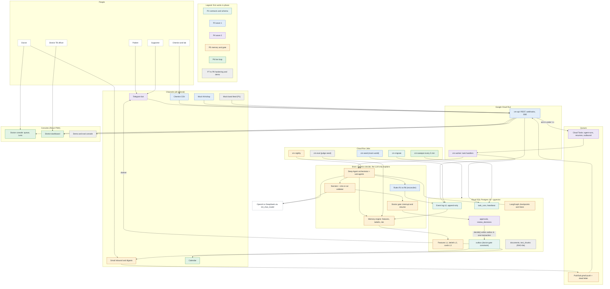
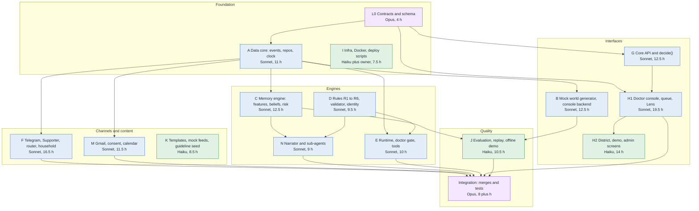
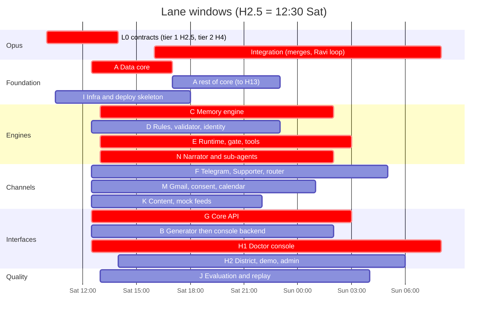
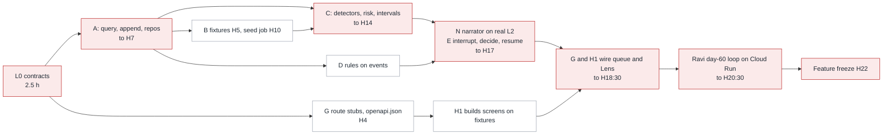
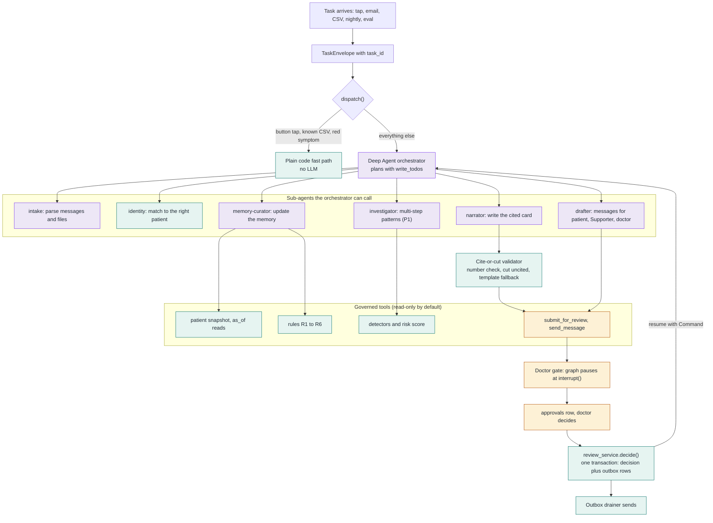
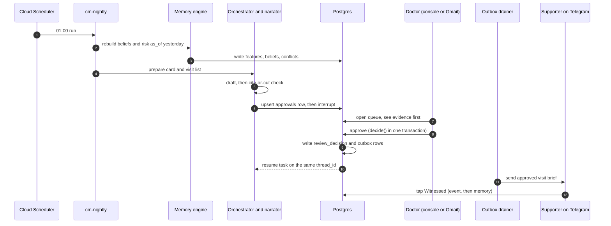

# CareMemory: phased architecture and agent plan (mermaid)

How to read this: the **system** is one architecture. It gets **built in 10 phases** (0 to 9) by **14 lane agents plus Opus**, each lane owning its own folders. Final names come from `INTEGRATION_DECISIONS.md`; the clock assumes H0 = 10:00 Saturday 24 Oct (confirm the real start).

Model key: **Opus** thinks and integrates. **Sonnet** and **Haiku** build. Runtime models inside the product are OpenAI or DeepSeek only.

---

## 1. The whole system, coloured by the phase in which each piece first works

Colour = the phase in which that piece first works end to end. Lanes keep refining it afterwards.



---

## 2. The 10 phases and the approval gates

Each phase is explained to you, you approve it, then it runs. Nothing moves on until its exit gate passes.

```mermaid
flowchart LR
  P0["Phase 0<br/>Pre-flight<br/>tonight"] --> G0{"Keys, accounts,<br/>scaffold-v0"}
  G0 --> P1["Phase 1<br/>Lock and go/no-go<br/>H0 to 0:30"]
  P1 --> P2["Phase 2<br/>Contract freeze<br/>H0:30 to 2:30"]
  P2 --> G2{"contracts-v1 tag,<br/>14 worktrees"}
  G2 --> P3["Phase 3<br/>Wave 1 build<br/>H2:30 to 6"]
  P3 --> M1{"Merge 1 at H6"}
  M1 --> P4["Phase 4<br/>Wave 2 build<br/>H6 to 10"]
  P4 --> C10{"Merge 2 and<br/>cut check H10"}
  C10 --> P5["Phase 5<br/>Memory, narrator, gate<br/>H10 to 14"]
  P5 --> C14{"Merge 3 and<br/>cut check H14"}
  C14 --> P6["Phase 6<br/>Live Ravi loop on GCP<br/>H14 to 18"]
  P6 --> P7["Phase 7<br/>Hardening<br/>H18 to 22"]
  P7 --> F22{"Feature freeze H22"}
  F22 --> P8["Phase 8<br/>Demo lock<br/>H22 to 30"]
  P8 --> V30{"Backup video H30"}
  V30 --> P9["Phase 9<br/>Rehearse and demo<br/>H30 to 36"]
  P9 --> D32{"No deploys<br/>after H32"}
```



### Timeline (clock time assumes a 10:00 start)

```mermaid
gantt
  title CareMemory build phases (H0 = 10:00 Sat 24 Oct, assumed)
  dateFormat YYYY-MM-DD HH:mm
  axisFormat %a %H:%M
  section Phases
  P0 Pre-flight (tonight)          :p0, 2026-10-23 20:00, 2026-10-24 10:00
  P1 Lock and go/no-go             :p1, 2026-10-24 10:00, 2026-10-24 10:30
  P2 Contract freeze               :crit, p2, 2026-10-24 10:30, 2026-10-24 12:30
  P3 Wave 1 build                  :p3, 2026-10-24 12:30, 2026-10-24 16:00
  P4 Wave 2 build                  :p4, 2026-10-24 16:00, 2026-10-24 20:00
  P5 Memory, narrator and gate     :crit, p5, 2026-10-24 20:00, 2026-10-25 00:00
  P6 Live Ravi loop on GCP         :crit, p6, 2026-10-25 00:00, 2026-10-25 04:00
  P7 Hardening                     :p7, 2026-10-25 04:00, 2026-10-25 08:00
  P8 Demo lock                     :p8, 2026-10-25 08:00, 2026-10-25 16:00
  P9 Rehearse and final demo       :p9, 2026-10-25 16:00, 2026-10-25 22:00
  section Checkpoints
  contracts-v1 tag (H2:30)         :milestone, m1, 2026-10-24 12:30, 0m
  Merge 1 (H6)                     :milestone, m2, 2026-10-24 16:00, 0m
  Cut check and merge 2 (H10)      :milestone, m3, 2026-10-24 20:00, 0m
  Cut check and merge 3 (H14)      :milestone, m4, 2026-10-25 00:00, 0m
  Feature freeze (H22)             :milestone, m5, 2026-10-25 08:00, 0m
  Backup video (H30)               :milestone, m6, 2026-10-25 16:00, 0m
```

---

## 3. Which agent builds what (14 lanes plus Opus)

Each lane edits only its own folders (`scripts/check_ownership.py` enforces it). Contracts are frozen, so lanes never wait on each other: each builds against fakes.



Total about 166 agent-hours plus about 12 Opus hours, which fits 14 lanes × 19.5 h (about 79% utilised with a 1.3× overrun).

### Lane timeline (same clock)



---

## 4. How the dependencies run (critical path in red)

The critical path is about 20.5 hours, with about 1.5 hours of slack before the H22 freeze.



If lane C slips past H14, lanes N and H1 keep working on the Ravi fixture snapshots, C lands by H17, and Integration absorbs it.

---

## 5. How a task becomes work: the Deep Agent orchestrator

Every incoming task (a Telegram tap, a Gmail reply, the nightly rebuild, an evaluation) becomes a standard envelope. Simple, known tasks skip the AI entirely.



---

## 6. One approval from start to finish



---

## 7. Phase by phase: goal, agents, output, gate

| Phase | Hours | Goal | Agents that run | Output | Exit gate |
|---|---|---|---|---|---|
| **0 Pre-flight** | tonight | Accounts, keys, repo ready | Coordinator (Sonnet), you | `.env`, GCP project, bots, `scaffold-v0` commit | Keys work, spend caps set, organiser check done |
| **1 Lock and go/no-go** | H0 to 0:30 | Confirm the plan is allowed and still right | Coordinator, Opus L0 starts | A go decision | You approve |
| **2 Contract freeze** | H0:30 to 2:30 | Freeze schemas and tables so lanes can run in parallel | **Opus L0**, Haiku I | `contracts-v1`, golden fixtures, 14 worktrees, ownership hook | `make contracts-check` green, tag exists |
| **3 Wave 1** | H2:30 to 6 | Foundations built against fakes | Up to 11 Sonnet and 2 Haiku: A, B, D, K, G, F, M, H1, H2, I, J | Event store and repos, mock-world generator, rules, templates, API stubs (`contracts-v1.1` at H4), first screens | Merge 1 at H6: seed runs on Cloud SQL, skeleton `cm-api` and `cm-worker` deployed |
| **4 Wave 2** | H6 to 10 | Channels, review service, console backend | Same lanes, plus B phase 2 | Telegram flow, `decide()`, outbox drainer, Gmail parse, consent, identity | Merge 2 at H10, then cut check |
| **5 Memory, narrator, gate** | H10 to 14 | The brain works on the real store | C, N, E (Opus reviews resume), Integration | Memory engine, risk with intervals, narrator and validator, orchestrator, nightly job | Merge 3 at H14, then cut check; Ravi day-3 and day-60 snapshots match fixtures |
| **6 Live Ravi loop on GCP** | H14 to 18 | One real loop from tap to approval to send | Integration (Opus), G, H1, E, F, M | Queue and Lens wired live, SSE, sweeper, district dashboard | Ravi day-60 loop passes end to end on Cloud Run |
| **7 Hardening** | H18 to 22 | Errors, edge cases, polish | All lanes in fix mode | Reliability tests, red-team tests, error states | **Feature freeze at H22** |
| **8 Demo lock** | H22 to 30 | Make the demo unbreakable | Integration, J, K | Fixed evaluation seeds, recorded-answer cassette, offline drill, twin accounts if P1 survived, backup video | Backup video by H30 |
| **9 Rehearse and final demo** | H30 to 36 | Practise and present | You, coordinator | Rehearsals, Q&A drill | No deploys after H32 |

### Cut list (pre-approved, applied at H10 and H14 in this order)
1. Channel kill switches and what-if view. 2. Timeline tab. 3. Charts tab. 4. Admin users page. 5. Escalation fast-forward. 6. Live updates (fall back to 5 s polling). 7. Supporter number replies. 8. Minimal household wizard.

**Never cut:** Memory Lens, review queue and doctor gate, cite-or-cut, Telegram check-in, rules R1 to R6, household screening with its KPI, the evaluation re-roll, offline replay.

### Usage-limit rule
The number of agents running drops as your usage meter rises (11, then 8, 5, 2). Agents keep a RESUME POINT in their `NOTES.md` and commit often. After a reset, resume them with a message.

---

## 8. What every agent receives (the context pack)

1. **Lane brief:** its folders, the spec section it implements, its start and finish hours, and what it depends on.
2. **Read first:** `caremem/MEMORY.md` (standing rules), `caremem/CLAUDE.md` (rules and lane table), `INTEGRATION_DECISIONS.md`, then its feature spec.
3. **Contracts and fixtures:** `cm/contracts/` (frozen), golden fixtures, and a fake for every dependency.
4. **OpenSpec duty (MEMORY.md Rule 1):** open a change, write the tasks, build, validate, archive. Bug fixes use `skip_specs: true`.
5. **Definition of done:** `make check` is green, its fakes exist, fixtures updated only through an RFC, and a short `NOTES.md` in its folder with a RESUME POINT.
6. **Stuck for more than 20 minutes:** write the blocker, stub with the fixture, and move on. Never redesign contracts.
7. **Never:** edit outside the lane, edit frozen contracts, put secrets in files, or commit or push unless the owner says so.
