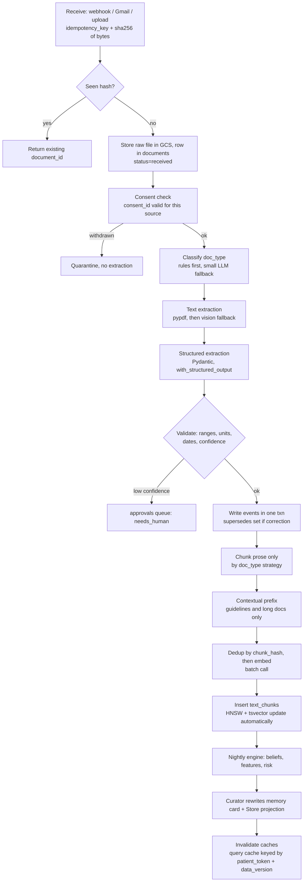

# CareMemory: RAG and long-term memory growth design

As of 2026-10-23. Aligns with `CAREMEMORY_ARCHITECTURE.md` section 4 and section 5. Claims I could not confirm are marked **UNVERIFIED**.

**Invariants (inherited, not re-opened):** the `events` table is the source of truth. The Store and all vectors are rebuildable caches. No vector store over structured events (arch 4.3). Structured numbers are never embedded.

## 1. What gets embedded and what stays relational

Architecture sec 4 already makes `guideline_chunks` the only vector table. This design extends it to a general `text_chunks` table that holds only the *unstructured prose* of arriving documents. Everything numeric stays in `events.payload`.

| Document | Relational (events, never embedded) | Embedded (prose only) |
|---|---|---|
| Lab report PDF/photo | Test name, value, unit, ref range, collected date, lab id | Free-text "remarks/impression" paragraph, if any |
| Prescription | Drug, dose, frequency, duration, prescriber, date | Doctor's free-text instructions (one chunk) |
| Chemist sales CSV | Every row (drug, qty, date, batch) | Nothing |
| Doctor email reply | Decision, dose changes parsed to fields | Body text (one chunk if short) |
| Supporter note | Mentioned dates/doses parsed to fields | Whole note (one chunk) |
| NTEP/MoHFW guideline PDF | Doc id, version, effective date | Section-aware chunks |
| Patient check-in message | Taken/missed, symptoms as coded fields | Optional free-text remark only |

Rule enforced in code: the extractor returns a Pydantic model with `structured: list[Event]` and `prose: list[str]`. Only `prose` reaches the chunker. A guard rejects any chunk whose text is more than 40% digits, so a mis-routed table cannot be embedded.

## 2. Ingestion pipeline



Events commit before chunks, so a failed embed never corrupts the log; a sweeper retries (arch 8A.2). Caches carry `patients.data_version`, bumped at the end of the pipeline.

## 3. Metadata schema

Use real **columns** for anything in a WHERE clause, and **JSONB** only for rarely filtered extras. This follows the pgvector guidance that filters apply after the ANN scan, so filter columns must be indexable.

Table `cm.documents` holds one row per source document. `cm.text_chunks` holds one row per chunk and repeats the filter columns (denormalised so no join sits in front of the vector search).

| Field | Type | Where | Notes |
|---|---|---|---|
| `patient_token` | text (`P-0042`) | column, in both | Null for guidelines (domain memory). Always the first filter |
| `doc_type` | enum | column | lab, prescription, sales_csv, email, supporter_note, guideline, checkin |
| `source` | text | column | telegram, gmail, upload, chemist_feed |
| `author_role` | enum | column | patient, supporter, doctor, lab, chemist, system |
| `occurred_at` | timestamptz | column | When it happened (sample date, visit date) |
| `received_at` | timestamptz | column | When we got it (maps to `recorded_at` in events) |
| `consent_id` | uuid FK | column | Needed for erasure by consent |
| `language` | text | column | Selects the tsvector config |
| `page`, `section` | int, text | JSONB `loc` | Citation display only |
| `confidence` | real | column | Extraction confidence, below 0.7 goes to review |
| `extraction_model` | text | column | Needed for re-extraction campaigns |
| `content_hash` | bytea | column, UNIQUE | sha256 of normalised text |
| `version`, `supersedes` | int, uuid | column | Updates (sec 6) |
| `sensitivity` | enum | column | normal, hiv_adjacent, mental_health. Narrator/audience filter |
| `retention_until` | date | column | Nightly purge job |
| `embedding_model`, `embedding_dims` | text, int | column | Re-embedding (sec 6) |
| `parent_id` | uuid | column | Parent-document retrieval |
| `status` | enum | column | active, superseded, withdrawn |
| `extra` | jsonb | JSONB | Anything else |

### Table and index choices

```sql
CREATE TABLE cm.text_chunks (
  chunk_id uuid PRIMARY KEY, document_id uuid NOT NULL, parent_id uuid,
  patient_token text, doc_type text NOT NULL, status text NOT NULL DEFAULT 'active',
  occurred_at timestamptz, consent_id uuid, language text, sensitivity text,
  content text NOT NULL, content_hash bytea NOT NULL,
  embedding halfvec(1536),
  tsv tsvector GENERATED ALWAYS AS (to_tsvector('simple', content)) STORED,
  extra jsonb
);

CREATE INDEX ON cm.text_chunks (patient_token, doc_type, occurred_at DESC) WHERE status='active';
CREATE INDEX ON cm.text_chunks USING gin (tsv);
CREATE INDEX ON cm.text_chunks USING hnsw (embedding halfvec_cosine_ops) WITH (m=16, ef_construction=64);
-- guidelines are a tiny, separate, patient-free set:
CREATE INDEX ON cm.text_chunks USING hnsw (embedding halfvec_cosine_ops)
  WHERE doc_type='guideline' AND status='active';
```

| Decision | Choice | Reason |
|---|---|---|
| HNSW vs IVFFlat | **HNSW** | pgvector docs: HNSW needs no training and gives better speed/recall; IVFFlat needs data first and tuning of lists/probes. Defaults `m=16`, `ef_construction=64`, `hnsw.ef_search=40` ([pgvector README](https://github.com/pgvector/pgvector)) |
| IVFFlat fallback | `lists = rows/1000`, `probes = sqrt(lists)` | Only if build memory becomes a problem (pgvector README) |
| Per-patient filtering | `SET hnsw.iterative_scan = relaxed_order` (pgvector 0.8.0+) | Filters are applied after the ANN scan, so a selective `patient_token` filter can return too few rows. Iterative scans keep scanning to `hnsw.max_scan_tuples` (default 20,000) |
| Tenant isolation | Hash or list partition by `patient_token` if over ~1M chunks; **UNVERIFIED** whether needed at pilot scale | pgvector README advises partitioning when filter values are many, partial indexes when few |
| Partial indexes | `WHERE status='active'` and a guideline-only index | Keeps superseded and withdrawn rows out of the graph |
| Storage type | `halfvec(1536)` | Half the memory; indexable to 4,000 dims (pgvector README). Cloud SQL's pgvector version must be at least 0.7.0 for halfvec: **UNVERIFIED** for Cloud SQL, check with `SELECT extversion FROM pg_extension WHERE extname='vector'` |
| tsvector config | `'simple'` (plus per-language later) | Telugu/Hindi have no built-in Postgres stemmer, so `simple` is the safe default (general PG knowledge; the [PG docs](https://www.postgresql.org/docs/16/textsearch-controls.html) show config is selected per call) |

At a few hundred chunks per patient, an exact per-patient scan is fast with perfect recall; HNSW matters mainly for guidelines and dashboards. Check plans with `EXPLAIN`.

## 4. Retrieval strategy

Every query: **route, then filter, then search, then fuse, then (maybe) rerank, then cite.**

| Stage | Design | Cost / benefit |
|---|---|---|
| Routing | LangGraph tool choice: numeric/temporal questions ("last 3 BP readings", "doses missed in week 6") go to a SQL tool over `events`/`features_daily` (read-only role `cm_reader`). Text questions ("what did the doctor say about vomiting") go to the RAG tool | Prevents embedding-based "similar numbers" errors. No extra LLM call: the agent's own tool selection does the routing |
| Pre-filter | `WHERE patient_token = $1 AND status='active' AND occurred_at <= $as_of AND received_at <= $as_of AND consent ok` before vector ORDER BY. `patient_token` is injected by the tool wrapper, never by the LLM | Isolation and bitemporal `as_of` (arch sec 4 temporal row) |
| Hybrid | Two queries (vector top-30, `tsv @@ websearch_to_tsquery` ranked by `ts_rank_cd` top-30), merged by **RRF**, `score = sum 1/(60 + rank)` | Catches drug names and acronyms that embeddings blur. Note: Postgres `ts_rank` is **not** BM25, since its ranking uses no global corpus statistics ([PG docs](https://www.postgresql.org/docs/16/textsearch-controls.html)). True BM25 needs an extension such as ParadeDB `pg_search` (**UNVERIFIED** on Cloud SQL, likely unavailable) |
| Chunking | Guidelines: structure-aware (split on headings/numbered clauses, 300 to 500 tokens, keep the heading path in `section`). Short notes, emails, check-ins: **one chunk per document**. Long emails/lab remarks: 300-token windows, 50 overlap | Fewer chunks means fewer embeddings and no split-sentence loss |
| Contextual retrieval | LLM-written 1 to 2 sentence prefix ("From NTEP 2025 guidelines, section on DR-TB follow-up") for **guideline chunks and chunks longer than 1 document-page only** | Anthropic reports top-20 retrieval failure down 35% (5.7% to 3.7%) with contextual embeddings, 49% with contextual BM25 added, 67% with reranking, at about $1.02 per million document tokens one-time with prompt caching ([Anthropic](https://www.anthropic.com/news/contextual-retrieval)). Skip for short notes since the metadata already supplies context |
| Parent-document | Child chunks (300 tokens) are searched, the parent (section or whole document, capped 1,500 tokens) is sent to the LLM, de-duplicated by `parent_id` | Better answer context, with search precision. Not needed for one-chunk documents |
| Reranking | **Off by default for patient memory** (candidate pool is under about 300 chunks, hybrid RRF is enough). **On for guidelines** (large corpus, doctor-facing) with top-30 reduced to top-5 | Cohere Rerank 3.5 is about $2.00 per 1,000 searches (third-party sources, **UNVERIFIED** against Cohere's official page; one source says $1). Self-hosted cross-encoder (BGE reranker v2 m3, open weights, multilingual) costs only CPU/GPU time, **UNVERIFIED** latency on Cloud Run CPU. Make it a config flag and let the eval (sec 7) decide |
| Citation | Each retrieved chunk gets `[C:chunk_id]`. The narrator's cite-or-cut validator (arch 3.8) drops sentences without a valid reference | Faithfulness |

## 5. Cost controls

| Lever | Setting | Evidence |
|---|---|---|
| Embedding model and dims | `text-embedding-3-small`, `dimensions=1536` default. Try 512 on the eval set. Large (3072) is not justified for this corpus | OpenAI: `dimensions` shortens vectors; MTEB 62.3% (small) vs 64.6% (large); about 62,500 pages per dollar for small vs 9,615 for large ([OpenAI embeddings guide](https://developers.openai.com/api/docs/guides/embeddings)). 512 dims cuts index size by about 3x. Recall impact on our data is **UNVERIFIED**, so measure it |
| Dedup | Skip embedding when `(content_hash, embedding_model, dims)` exists, also across patients for guidelines | Exact |
| Batch embedding | Backfills and re-embeds via the OpenAI Batch API: 50% discount, 24h window, `/v1/embeddings` supported, 50,000 inputs per batch ([OpenAI Batch guide](https://developers.openai.com/api/docs/guides/batch)). Live ingest stays synchronous (seconds matter for check-ins) | Confirmed |
| Query cache | Key = `hash(patient_token, normalised_query, data_version)`, TTL 24h, in Postgres (no Redis, per arch 4.3) | Invalidated by `data_version` bump |
| Prompt caching (OpenAI) | Put the static system prompt and tool schemas first, dynamic patient context last. Prefix of at least 1,024 tokens; cache reads cost up to 90 to 95% less depending on model ([OpenAI prompt caching](https://developers.openai.com/api/docs/guides/prompt-caching)) | Confirmed. Model-specific rates: check the pricing page |
| Prompt caching (DeepSeek) | Automatic on-disk prefix cache, best effort, reported as `prompt_cache_hit_tokens` ([DeepSeek KV cache](https://api-docs.deepseek.com/guides/kv_cache)). Pricing page lists cache-hit input at about 2% of cache-miss (flash: $0.003 vs $0.15 per 1M off-peak; peak rates 2x) ([DeepSeek pricing](https://api-docs.deepseek.com/quick_start/pricing)) | Confirmed from the pages as fetched. Prices change often, so re-check |
| Guidelines | Embedded once at seed, keyed by `content_hash`. Re-embed only on a new guideline version | About 40 to a few hundred chunks, under $0.01 |
| Skip embedding | Short check-ins with no free text, CSVs, structured fields | Largest saving |

### Estimated cost per patient per month (my assumptions, not measured)

Assumed: 30 check-ins (10 with remarks, about 40 tokens), 4 supporter notes (150 tokens), 2 doctor emails (300), 1 lab remark (200), 1 prescription note (100). About 2,000 embedded tokens per month, 60 RAG queries (about 30 tokens each), 4 memory-card regenerations.

| Item | Volume | Unit price | Cost |
|---|---|---|---|
| Document embeddings (small) | about 2K tokens | about $0.02 per 1M (derived from pages-per-dollar) | under $0.0001 |
| Query embeddings | about 2K tokens | same | under $0.0001 |
| Contextual prefixes | about 0 (short notes skipped) | n/a | about $0 |
| Storage (halfvec 1536 = about 3 KB, 60 chunks) | about 200 KB incl. index | Cloud SQL storage | negligible |
| Chat LLM for cards and Q&A | 4 cards x about 6K in / 1K out, plus 60 answers x about 3K in / 300 out | DeepSeek flash miss $0.15 / out $0.6 per 1M | about $0.01 to $0.03 |
| **Total** | | | **about $0.01 to $0.05 per patient-month** |

The LLM dominates; retrieval is nearly free.

## 6. Updates and versioning

| Event | Action |
|---|---|
| Corrected lab report | New `documents` row with `supersedes = old_id`, `version+1`. New events carry `supersedes` (arch sec 5 `events.supersedes`). Old chunks get `status='superseded'` (stay for audit, excluded from retrieval by the partial index and filter). Beliefs rebuild nightly from non-superseded events |
| Same file re-sent | `content_hash` match, no-op |
| Consent withdrawn (arch 4.2) | Immediate: `UPDATE text_chunks SET status='withdrawn' WHERE consent_id = $1` (retrieval filter excludes at once). Hard `DELETE` of those vectors in the next batch (within 24h, **UNVERIFIED** against the DPDP timeline: confirm with counsel). Full erasure: delete all chunks for the patient, and crypto-shred the DEK so any `content` column text is unreadable (store `content` encrypted under the patient DEK, tsvector/embedding then become the leak surface, so for erasure delete them too) |
| Embedding model change | Add `embedding_v2 halfvec` column, backfill via Batch API, flip the `embedding_model` setting, build the second HNSW index, then drop the old column. Never mix models in one index (different spaces). `embedding_model` column makes this auditable |
| Retention | Nightly job deletes `retention_until < today` |
| Extraction model change | Re-extract only docs with `confidence < 0.7` or when the schema changes. Raw files are in GCS, so everything is rebuildable |

## 7. Evaluation

| Test | Method | Target (initial, my proposal) |
|---|---|---|
| Retrieval recall@k | 40 to 60 labelled (query, gold chunk ids) pairs built from the simulator (`cm/eval`), covering all doc types and Hinglish/Telugu phrasings. Report recall@5 and recall@10, per variant: vector-only, FTS-only, hybrid, hybrid + rerank, 512 vs 1536 dims | Hybrid recall@10 at least 0.9; choose cheapest variant within 2 points of the best |
| Isolation | Adversarial queries naming another patient's token. Assert zero cross-patient chunk ids returned | 100% |
| Temporal leakage | Query at `as_of = day 44` must not return a day-45 chunk | 100% |
| Faithfulness | Cite-or-cut already measures `cut_ratio` (arch 3.8). Add an LLM-judge check that each kept sentence is entailed by its cited chunk, sampled 20 cards | At least 95% entailed. Judge is itself a model, so spot-check by hand |
| Numeric safety | Property test: no chunk contains a vitals/dose table (digit-ratio guard) | 0 |
| Latency / cost | p95 retrieval ms, tokens per answer, logged to `jobs` | p95 under 300 ms retrieval |

## 8. LangChain / LangGraph components

| Need | Use | Why |
|---|---|---|
| Patient and guideline vector search | **`PGVectorStore`** from `langchain-postgres` (not the old `PGVector`) | The README says `PGVector` is deprecated from v0.0.14 in favour of `PGVectorStore`; it supports hybrid search via `HybridSearchConfig` with an RRF fusion function ([langchain-postgres](https://github.com/langchain-ai/langchain-postgres)). Metadata-as-columns support in `PGVectorStore` is **UNVERIFIED** from the README; if absent, use raw SQL via `psycopg` for the retrieval tool (about 40 lines) and keep LangChain only for embeddings and loaders |
| Old `PGVector` | JSONB metadata, no migration path for schema changes ([docs](https://docs.langchain.com/oss/python/integrations/vectorstores/pgvector)) | Avoid |
| Agent-facing memory (cards, playbooks, edit examples) | **LangGraph `PostgresStore`** with `index={"embed":..., "dims":1536}`, `store.put` / `store.search` by namespace ([LangGraph memory docs](https://docs.langchain.com/oss/python/langgraph/add-memory)) | Already in the architecture as a projection. Small, namespaced, per-doctor/per-patient items. Do not put document chunks here: you lose typed filter columns, `status`, `consent_id` and the hybrid query |
| PDF with text layer | `PyPDFLoader` (pypdf) | Fast, free, page numbers in metadata |
| Complex layouts, tables | `unstructured` (`partition_pdf`, hi_res) | Heavier dependencies; use only for NTEP guideline PDFs, once, offline |
| Scanned PDF / lab photo | **Vision fallback**: send the image to a vision-capable chat model with `with_structured_output(LabReport)`. Trigger when pypdf yields under about 200 chars per page | A model call per document, but lab reports arrive about once a month per patient. Always store `confidence` and route low scores to review |
| Splitters | `MarkdownHeaderTextSplitter` then `RecursiveCharacterTextSplitter` for guidelines | Heading path becomes `section` |

## 9. Implementation checklist

| # | Step | Component | Library | Priority | Hours |
|---|---|---|---|---|---|
| 1 | `documents` and `text_chunks` DDL, enum types, indexes, `halfvec`, version check | `cm/db/migrations` | psycopg, Alembic | P0 | 3 |
| 2 | Ingest receiver with sha256 idempotency and GCS raw store | `cm-api` | FastAPI, google-cloud-storage | P0 | 3 |
| 3 | Doc-type classifier (rules, then small LLM) | `cm/ingest/classify.py` | LangChain | P0 | 2 |
| 4 | Extractors per doc type (Pydantic) with validators and confidence | `cm/ingest/extract/` | pydantic, `with_structured_output` | P0 | 6 |
| 5 | PDF text path and vision fallback | `cm/ingest/loaders.py` | pypdf, a vision chat model | P0 | 3 |
| 6 | Event write with `supersedes` (reuse intake agent) | `cm/store` | psycopg | P0 | 2 |
| 7 | Chunkers: one-chunk, windowed, heading-aware; digit-ratio guard | `cm/ingest/chunk.py` | langchain-text-splitters | P0 | 3 |
| 8 | Embed with dedup by hash, batching, `dimensions` setting | `cm/ingest/embed.py` | langchain-openai | P0 | 2 |
| 9 | Retrieval tool: pre-filter, vector + FTS, RRF in SQL, `as_of`, token injection | `cm/tools/rag.py` | psycopg (or PGVectorStore) | P0 | 5 |
| 10 | SQL tool for numeric/temporal questions | `cm/tools/sql.py` | psycopg, `cm_reader` role | P0 | 3 |
| 11 | Cite-or-cut hooks for `[C:id]` refs | existing validator | none | P0 | 2 |
| 12 | Consent withdrawal: status flip and delete job; supersede logic | `cm/ingest/lifecycle.py` | psycopg | P0 | 3 |
| 13 | Retrieval eval set and recall@k / isolation / leakage tests | `cm/eval` | pytest | P0 | 4 |
| 14 | Guideline seed with contextual prefixes and heading-aware chunks | seed script | unstructured (offline), Anthropic or DeepSeek model | P1 | 4 |
| 15 | Reranker flag (Cohere or cross-encoder) for guidelines | `cm/tools/rag.py` | cohere or sentence-transformers | P1 | 3 |
| 16 | Parent-document expansion | `cm/tools/rag.py` | SQL | P1 | 2 |
| 17 | Query cache keyed by `data_version` | `cm/tools/cache.py` | psycopg | P1 | 2 |
| 18 | Batch API re-embed job | `cm-nightly` | openai | P1 | 3 |
| 19 | Faithfulness judge on sampled cards | `cm/eval` | LangChain | P1 | 3 |
| 20 | 512-dim vs 1536-dim ablation | `cm/eval` | none | P1 | 2 |
| | **P0 total** | | | | **41** |
| | **P1 total** | | | | **19** |

For the 36-hour build, do P0 items 1 to 9 and 11 first and demo with guidelines plus Supporter notes.

UNVERIFIED items are marked inline (Cloud SQL pgvector version, PGVectorStore metadata columns, rerank price/latency, 512-dim recall, DPDP timelines, per-patient cost assumptions).
